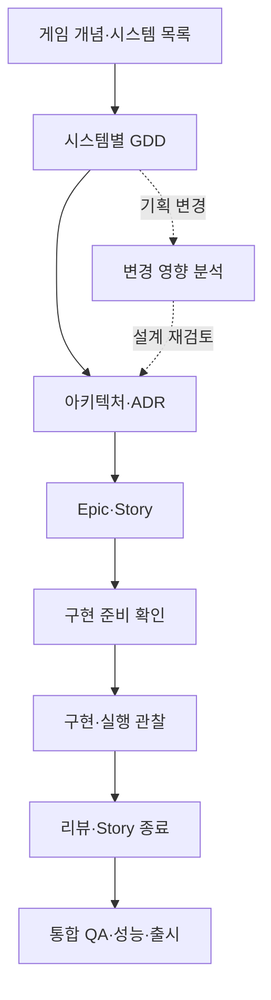

# CCGS v1.3 프로젝트 적용 레퍼런스

> 작성일: 2026-11-10 (한국 시간)  
> 최종 갱신·로컬 대조: **2026-11-11** (한국 시간)  
> 목적: 개발 중인 게임 프로젝트에서 필요한 구성만 선택해 가져오기 위한 참고 문서.  
> 분석 기준: **CCGS v1.3.0**, 커밋 `abc0de79d6ceb0b5d7aa693945849b3937afbe6a` (2026-11-09 배포).  
> 로컬 위치: `C:/Users/Sangha_Remote/Documents/Claude-Code-Game-Studios`. 원본은 읽기 전용으로 확인했으며, 원본 스크립트·훅은 실행하지 않았다.

이 문서는 CCGS의 **확인된 동작**, **도입 판단**, **TrackBuilding의 현재 상태**를 구분한다. 도입 판단은 제안이며 프로젝트의 확정 규칙을 바꾸지 않는다. 분석 문서와 진행 기록만 작성했고, CCGS 기능을 설치하거나 기존 스킬을 변경하지 않았다.

확인 방법은 v1.3.0 소스·설정 읽기와 파일 수·색인·참조 경로 대조다. 모든 스킬을 실제 게임에서 실행한 검증은 아니다. 특히 원본 README도 엔진 경로와 상세 기획 경로가 브라우저 첫 빌드와 같은 수준의 실사용 비교 검증을 거치지는 않았다고 밝힌다. [S01]

## 목차

- [1. 이 문서를 사용하는 방법](#use)
- [2. CCGS의 구조와 작업 방식](#structure)
- [3. 작업 흐름과 문서 인계](#pipeline)
- [4. 설정·승인·리뷰 강도의 분리](#configuration)
- [5. 세션과 컨텍스트 관리](#context)
- [6. 에이전트와 위임](#agents)
- [7. Rules·Hooks·권한](#automation)
- [8. 보조 스크립트와 의존성](#helpers)
- [9. 검증·리뷰·완료의 의미](#verification)
- [10. 아트·UX·출시 구성](#content-release)
- [11. 기존 프로젝트 도입 절차](#adoption)
- [12. TrackBuilding 적용 판단표](#trackbuilding)
- [13. 단계별 도입 묶음과 확인 기준](#roadmap)
- [14. 복사 전에 확인할 한계](#limits)
- [15. 원본을 읽는 순서와 유지보수](#reading)
- [부록 A. 전체 스킬 색인](#skills-index)
- [부록 B. 전체 에이전트 색인](#agents-index)
- [출처](#sources)

## 1. 이 문서를 사용하는 방법

먼저 현재 겪는 문제를 고른 뒤 해당 구성의 원본과 의존성을 함께 확인한다.

| 겪는 문제 | 먼저 볼 구성 | 이 문서 |
|---|---|---|
| 새 세션에서 결정과 다음 할 일을 잊음 | 체크포인트, 시작 훅, 작업 종료 시 갱신 | §5 |
| 기획이 모호해 구현할 때마다 다시 결정함 | 시스템별 상세 기획, 수용 기준, 질문 기록 | §3, §12 |
| 기획 변경 뒤 설계가 뒤처짐 | 변경 영향 분석, 결정 상태, 요구사항 연결 | §3.3, §11 |
| 구현 작업의 범위와 완료 조건이 불명확함 | Story 형식, readiness, 구현·종료 인계 계약 | §3.2, §9 |
| 리뷰가 오래되거나 같은 파일을 반복해서 읽음 | 내용 해시, 섹션 읽기, 관찰값 스크립트 | §8 |
| 검증을 실행하지 않았는데 완료로 보고됨 | NOT ASSESSED, 실행 증거, 검사별 판정 | §9 |
| 여러 역할이 같은 파일이나 결정을 중복 수정함 | 역할 경계, 산출물 계약, 의존 순서 | §6 |
| 출시 전에 해야 할 일이 흩어짐 | 출시·런치 체크리스트, 회귀·성능·장시간 테스트 | §10 |

도입 상태는 다음 뜻으로 쓴다.

| 표시 | 뜻 |
|---|---|
| 기존 활용 | 프로젝트에 이미 같은 목적의 구성이 있다. 중복 도입보다 보완점을 비교한다 |
| 우선 검토 | 가까운 작업에서 효과가 크다. 도입 범위를 먼저 정한다 |
| 조건부 | 특정 기능·자료·반복 작업이 생기면 가져온다 |
| 후순위 | 지금 도입하면 관리 비용이 효과보다 크다 |
| 제외 권장 | 현재 프로젝트의 구조·정책·엔진과 맞지 않는다 |

공통 원칙은 **해결할 문제 → 읽을 입력 → 작성할 산출물 → 다음 사용처 → 확인 방법**을 먼저 정하는 것이다. 스킬 파일 하나가 있어도 이 연결이 없으면 작동하는 작업 흐름이 되지 않는다.

## 2. CCGS의 구조와 작업 방식

### 2.1 무엇을 제공하는가

CCGS는 Claude Code에 게임 개발 절차를 부여하는 파일 모음이다. 역할 정의, 실행 절차, 문서 형식, 자동 이벤트 처리, 관찰값 도구가 서로 연결된다. 엔진 프로젝트·완성 게임·독립 실행 서비스는 사용자가 갖추거나 해당 절차로 생성한다.

| 층 | 원본 위치 | 맡는 역할 | 가져올 때의 단위 |
|---|---|---|---|
| 진입 지침 | `CLAUDE.md` | 프로젝트 정보, 협업 원칙, 항상 필요한 연결 | 짧은 원칙과 문서 안내 |
| 역할 | `.claude/agents/` | 전문 분야, 입력, 판단·수정 경계 | 필요한 역할만 |
| 절차 | `.claude/skills/<name>/SKILL.md` | 단계, 질문, 입력·출력, 완료 보고 | 본문 + references + 호출 의존성 |
| 인계 계약 | 일부 스킬의 `CONTRACT.md` | 입력 필드, 출력 보장, 불변 영역, 다음 단계 기대 | 인접 단계와 한 묶음 |
| 규칙 | `.claude/rules/` | 경로에 맞는 작성·검사 원칙 | 프로젝트 경로에 맞춰 재작성 |
| 이벤트 | `.claude/hooks/`, `.claude/settings.json` | 시작·읽기·쓰기·커밋·응답 종료 등의 처리 | 훅 + 설정 + helper |
| 결정적 도구 | `.claude/scripts/` | 상태·숫자·차이·형식·실행 결과 관찰 | 스크립트 + 입력 형식 + 결과 해석 |
| 운영 문서 | `.claude/docs/` | 설정 해석, 리뷰 모드, 실패 복구, 컨텍스트 원칙 | 실제로 필요한 참조 절만 |
| 산출물 형식 | `.claude/docs/templates/` | 기획·ADR·Story·QA·출시 문서 형식 | 작성 스킬과 읽는 스킬을 함께 |
| 엔진 지식 | `docs/engine-reference/` | 버전·API·호환성 근거 | 검증한 범위만 |
| 자체 QA | `studio-tests/` | 스킬·에이전트의 구조·행동·범주 검사 | 게임 테스트와 별도로 |
| 엔진·장르 자료 | `.claude/engines/`, `.claude/genres/` | 엔진별 경로·명령 표, 장르별 질문·브리프 자료 | 해당 경로를 사용하는 기능과 함께 |

원본 파일 트리, 설정, 문서 설명을 대조했다. [S01] [S03] [S04]

### 2.2 구성 수와 집계 기준

2026-11-11에 v1.3.0의 파일과 설정을 기준으로 집계했다.

| 집계 대상 | 수량 |
|---|---:|
| 에이전트 정의 파일 | 49 |
| 실제 `SKILL.md` 파일 | 78 |
| 독립 기능으로 안내하는 스킬 | 75 |
| 설정에 연결된 훅 명령 | 15 |
| hooks 아래 `.sh` 파일 | 18 |
| Rules 파일 | 14 |
| scripts 아래 `.sh` 파일 | 49 |
| templates 아래 전체 파일, 하위 guidance 포함 | 74 |

78개 스킬 파일 중 3개는 호환 별칭이다. `help → next-step`, `settings → project-settings`, `changelog → write-changelog`다. 기능 75개에 별칭 3개를 더한 수다. hooks의 나머지 파일은 설정에 직접 연결한 이벤트 훅 외 helper·업데이트·진단 용도다. 따라서 README의 15 hooks와 폴더의 18개 파일은 집계 기준이 다르다. [S04], [S05]

### 2.3 작업 방식과 적용 범위

CCGS는 브리프를 바탕으로 브라우저 게임을 만들고 플레이하며 수정·확장하는 경로와, 에이전트·기획 문서·Story 절차를 사용하는 **Studio mode**를 제공한다. 기존 엔진 프로젝트에서는 현재 작업과 엔진 설정에 맞는 경로를 선택한다.

| 구성 | 동작 | Unreal 기존 프로젝트에 대한 판단 |
|---|---|---|
| `/prototype` | 질문 → 1쪽 브리프 → 브라우저 게임 → 짧은 실행·화면 검사. 엔진 설정이 있으면 엔진·종이 실험 경로 제공 | 질문·브리프·검증 범위 표시는 참고. 웹 빌드는 목적을 확인한 뒤 선택 |
| Web 개발 | Vite·TypeScript, smoke, 같은 seed의 재생 경로 | UE의 빌드·네트워크 검증을 대체하지 않음 |
| `/cut` | 범위 축소, 마무리 목록, 판매 목표의 일정·동결 기록 | 기능이 누적될 때 유용. 동결일 자체를 강제하는 기능은 아직 없음 |
| 관점별 검토 | design-system은 전문 역할의 관점을 적용하고, architecture-review는 엔진 검토를 본 세션에서 수행 | 역할 수보다 실제 분리가 필요한 일을 기준으로 도입 |
| 엔진 경로 해석 | `engines.tsv`, 선택적 `engine.code_root`·`engine.test_root` | 현재 프로젝트 경로와 반드시 대조 |
| Windows 훅 실행 | Git Bash가 없으면 훅을 생략하고 시작 때 알림 | 훅이 실행됐는지 관찰해야 함 |
| 읽기 전용 helper 권한 | 해당 명령에 대한 세션 공통 allow | 필요한 명령만 현재 권한 설정과 병합 |

원본 `/prototype`은 엔진이 없거나 Web이면 브라우저 경로로 간다. 기존 Unreal 프로젝트를 분석할 때 이 분기를 생략하면 엉뚱한 웹 산출물을 만들 수 있다. [S02], [S06]

## 3. 작업 흐름과 문서 인계

### 3.1 Studio의 전체 흐름

일곱 단계는 Concept → Systems Design → Technical Setup → Pre-Production → Production → Polish → Release다. 단계의 파일 존재·패턴 검사는 `workflow-catalog.yaml`과 `artifact-check.sh`가 연결하고, 다음 행동 안내가 이를 사용한다.

다만 `workflow: minimal`은 별도 짧은 경로다. 엔진과 game-brief → create-stories → dev-story → story-done으로 진행하며, create-epics·스프린트·전체 단계 사다리를 필수로 요구하지 않는다. v1.3.0의 웹 확장 경로에는 사용자가 Story를 요청하지 않으면 기능 단위로 직접 구현하는 경로도 있다. 모든 프로젝트가 위 그림의 문서를 전부 만들어야 하는 구조로 이해하면 과도한 도입이 된다. [S07] [S08]

### 3.2 단계별로 넘겨주는 것

| 단계·원본 | 입력 | 핵심 산출물 | 다음 단계가 기대하는 것 |
|---|---|---|---|
| brainstorm / map-systems | 아이디어, 목표, 제약 | 개념·brief, 시스템 목록·의존 순서 | 무엇을 만들지와 우선순위 |
| design-system | 해당 시스템의 개념·연결 시스템 | 규칙, 상태, 예외, 수치, 수용 기준 | 구현자가 추측하지 않아도 되는 동작 |
| create-architecture | 승인된 기획 | 계층, 소유권, 데이터 흐름, API 경계 | 각 요구사항을 어디서 구현하는지 |
| architecture-decision | 기술 선택 문제, 기획·엔진 근거 | ADR의 상태·결정·대안·구현 지침 | 제안과 채택의 구분, 의존 결정 |
| create-control-manifest | 채택된 ADR | 구현자가 따를 평면 규칙 목록 | 흩어진 결정의 실행 지침 |
| create-epics | 기획·설계·요구사항 연결 | 모듈별 Epic, 관할 ADR·요구사항 | 작업 묶음의 범위·완료 정의 |
| create-stories | Epic 또는 minimal brief | Story, 수용 기준, 범위 밖, 파일·증거·의존성 | 바로 집어 구현할 수 있는 작업 |
| story-readiness | Story와 현재 설계 상태 | READY / NEEDS WORK / BLOCKED | 구현 전에 해결할 빈 곳 |
| dev-story | 준비된 Story, 채택 결정 | 코드·필요 증거·실행 결과·체크포인트 | 실제 변경 파일과 검증 범위 |
| story-done | 구현 결과, 기준·증거 | 판정, 종료 기록, 다음 작업 | 완료 이유와 남은 위험 |
| smoke-check / gate-check | 현재 빌드, 테스트·기획·증거 | 실행 결과, 통합·단계 판정 | 기능끼리 함께 동작하는 근거 |

**가져올 핵심은 필드 사이의 연결이다.** 예를 들어 요구사항 번호를 Story에 쓰기로 했다면, 생성 스킬·검토 스킬·변경 영향 분석이 같은 번호를 읽어야 한다. 제목·상태·표 열·경로를 바꾸면 이 소비자도 함께 바꾼다. 주요 Story 단계는 `CONTRACT.md`에 입력·출력·불변 영역·취약점을 따로 적어 둔다. [S09] [S10] [S11]

### 3.3 기획 변경이 생겼을 때

`propagate-design-change`는 바뀐 GDD의 diff를 보고 관련 ADR을 분류한다. 영향 없음 / 재검토 / 대체 가능성이 큰 결정으로 나누고, 사용자가 유지·수정·대체·보류를 선택한다. 원본이 직접 쓰는 ADR 변경은 승인받은 Status의 Superseded 처리이며, 대체 ADR 작성과 코드 수정까지 자동 완료하는 기능은 아니다.

TrackBuilding에 옮기려면 `GDD → TR registry → ADR` 연결을 현재의 `상세 기획 절 → REQ-<단위>-NNN → 단위 설계·ADR` 연결로 바꿔야 한다. 이후 Story·코드·테스트까지 영향 범위를 넓힐지는 별도로 설계한다. 현재 프로젝트에서는 그 확대 작업이 보류돼 있다. [S12]

## 4. 설정·승인·리뷰 강도의 분리

### 4.1 서로 다른 조절 항목

| 항목 | 조절하는 것 | 혼동하면 생기는 문제 |
|---|---|---|
| `modes.workflow` | 구현 전에 어떤 문서가 필요한가 | 문서가 적다는 이유로 실행 검증까지 생략 |
| `modes.automation` | 어떤 결정·쓰기를 물어보는가 | 질문 수를 줄이는 설정을 품질 완화로 이해 |
| `modes.review_mode` | 별도 director 리뷰를 얼마나 실행하는가 | solo를 코드·테스트 전체 생략으로 이해 |
| `qa.level` | 테스트·증거 요구 수준 | 파일 존재와 테스트 통과를 혼동 |
| `docs.density` | 문서 한 절의 자세함 | 필수 절 유무와 설명 길이를 혼동 |
| `team.size` | 개별 역할 또는 Studio 묶음 | 49개 역할이 항상 동시에 도는 것으로 이해 |
| `modes.rigor` | 위 일부 항목을 함께 정하는 상위 묶음 | 하위 명시값이 상위 변경을 가리는 문제 |

rigor가 명시값이 없는 여섯 항목에 주는 값은 다음과 같다.

| rigor | workflow | density | QA | Story 크기 | 리뷰 | 팀 |
|---|---|---|---|---|---|---|
| minimal, 기본 | minimal | terse | minimal | coarse | solo | individual |
| standard | standard | balanced | standard | balanced | lean | individual |
| full | full | thorough | full | fine | full | studio |

automation의 기본은 collaborative다. guided는 큰 결정은 묻고 작은 결정은 알린 뒤 진행하며, autonomous는 예외 항목을 제외한 결정을 기록하고 진행한다. 기본 항상 질문 범주는 범위 변경·파일 삭제·스키마 변경이다. 이들은 **원본의 정책 설명**이며 현재 프로젝트에 자동 적용되는 정책이 아니다. [S13] [S14]

### 4.2 설정 해석도 하나의 기능이다

해석 순서는 허용된 로컬 설정 → project.yaml → 해당되는 legacy 파일 → rigor 파생값 → 기본값이다. 각 값에는 어느 출처에서 왔는지 표시한다. 모든 키가 로컬 재정의를 허용하지는 않는다.

스킬 본문의 동적 명령으로 설정을 먼저 계산하는 구조는 `yaml-helper.sh`, 프로젝트 설정, Claude Code의 스킬 전처리와 정확한 권한 패턴에 의존한다. 단순히 SKILL.md를 복사하면 이 첫 단계에서 실패할 수 있다. 실제로 설정·문서·스크립트의 버전이 함께 맞아야 하는 부분이다.

**TrackBuilding 판단:** 이미 검증을 변경 단위 규칙과 `verify-full`로 나누기로 했다. CCGS의 전체 모드 계층을 먼저 가져오기보다, 반복해서 바꿀 필요가 생긴 설정만 도입한다. 기존 규칙을 유지하면서 원본에 남은 mode 참조를 삭제·대체하는 쪽이 현재 구성에 맞는다. [S13]

## 5. 세션과 컨텍스트 관리

### 5.1 기억을 보관하는 층

| 층 | 저장 내용 | 사용 시점 |
|---|---|---|
| 프로젝트 지침 | 목적, 구조, 짧은 규칙, 읽기 트리거 | 시작·관련 파일 접근 |
| 작업 체크포인트 | 현재 작업, 다음 행동, 막힌 점, 작업 파일, 실행 결과 | 새 세션·clear·compact 이후 |
| 상세 문서 | 승인된 기획, 결정 이유, 구현 설계 | 해당 작업이 필요할 때 |
| 이력 | 이전 상태, 시도·실패 이유, Git 활동 | 경위 조사·복구 |
| 일부 에이전트의 project memory | 해당 역할이 배운 방법·패턴 | 같은 역할을 다시 사용할 때 |

대화에서만 합의한 사실의 복원 범위는 보장하지 않는다. 중요한 결정과 재개 지점이 파일로 남아 있어야 한다.

### 5.2 자동 복원과 기록 책임

`production/session-state/active.md` 안의 CHECKPOINT 블록을 시작 훅이 자동으로 넣는다. 주입량은 최대 25줄·3,000자다. STATUS 블록은 진행 위치 표시용이고, CHECKPOINT 아래 자유 서술은 자동 주입 대상이 아니다.

| 동작 | 자동 여부·책임 |
|---|---|
| 현재 상태를 의미 있게 요약해 쓰기 | 스킬·에이전트의 기록 책임 |
| 체크포인트 교체·append | `session-state.sh`가 형식에 맞게 처리 |
| 새 세션·clear·compact 후 복원 | 등록된 `SessionStart`가 처리 |
| 응답이 끝날 때 상태 보관 | async `Stop` 훅이 변경된 파일을 보관 |
| 압축 직전 새 요약 생성 | `pre-compact.sh`는 하지 않음. 압축 발생만 기록 |
| 긴 자유 서술 이력 이동 | `rotate-session-state.sh` 명시 실행. 시작 훅은 권고만 |

dev-story·story-done은 결과와 관계없이 체크포인트를 갱신하도록 명시한다. Stop 훅은 대화를 읽어 새 요약을 만드는 기능이 아니다. 일반 대화나 자체 제작 스킬이 기록을 빼먹으면 자동 복원도 오래된 상태를 읽게 된다. [S15] [S16] [S17]

### 5.3 도입할 때 지켜야 할 형식

- CHECKPOINT는 이전 블록을 교체한다. 최신 상태가 뒤에 계속 쌓이는 방식으로 만들지 않는다.
- 현재 작업·정확한 다음 행동·막힌 점·열린 질문·관련 파일·검증 결과를 짧게 쓴다.
- 결정 이유, 실패한 시도, 다시 시도하면 안 되는 조건은 상세 이력이나 결정 문서에 둔다.
- 브랜치를 기록하고 현재 작업 트리와 맞는지 확인한다.
- 같은 체크아웃에서 병렬 세션이 하나의 active.md를 쓰면 충돌할 수 있다. 작업·worktree별 분리는 이식 설계에서 정한다.
- 원본의 상태·이력은 Git 제외다. 다른 PC·새 clone에서 공유하려면 별도 정책이 필요하다.
- 시작 훅에 대규모 코드 검색·빌드·네트워크 요청을 추가하지 않는다. 복원 정보가 훅 시간 제한 전에 출력돼야 한다.

**TrackBuilding 판단:** 현재 ax-setup은 progress.md를 읽고 종료 전에 갱신하는 방식이다. 게임 개발 단계로 확장할 때는 짧은 재개 상태와 누적 진행 이력을 나누고, 세션 시작에 짧은 부분을 자동 주입하는 구성을 우선 검토한다. 위치와 Git 공유 여부는 아직 확정하지 않는다.

## 6. 에이전트와 위임

### 6.1 계층의 목적

원본은 방향을 정하는 leadership, 부문을 맡는 lead, 실제 작업을 맡는 specialist로 역할을 나눈다. 엔진별 전문 역할도 있다. **역할 정의 49개는 제공되는 선택지의 수**이며, 매 작업의 실행 수가 아니다.

가져올 때는 조직도보다 다음 계약이 중요하다.

| 위임 항목 | 반드시 명시할 것 |
|---|---|
| 입력 | 프로젝트 목적, 이번 요구, 필요한 파일·절, 현재 상태 |
| 경계 | 읽기 전용인지, 어떤 파일을 새로 쓰거나 고칠 수 있는지 |
| 산출물 | 정확한 파일 경로 또는 반환 형식 |
| 판단 | 통과·실패·확인 불가의 뜻과 근거 |
| 의존성 | 다른 역할의 결과가 필요한지 |
| 종료 | 요약, 근거 위치, 미확인 부분, 다음 단계 |

산출물 경로를 약속했다면 파일이 실제로 있는지 확인한 뒤 다음 단계로 넘어간다. 한 역할이 막히면 의존하는 단계를 계속 진행하지 않고, 완료된 부분과 빠진 부분을 함께 보고한다. [S18]

### 6.2 병렬화와 독립 리뷰

같은 입력만 공유하고 서로의 출력이 필요 없는 조사는 병렬화할 수 있다. 앞 단계의 결정이 필요한 구현은 순차 진행한다. 같은 파일의 병렬 편집은 별도 조정 없이 사용하지 않는다.

원본의 team-*는 한 세션 안의 subagent 조정이다. 실험적 Agent Teams는 독립 세션들을 공유 작업 목록으로 연결하는 별도 기능이다. team-*를 가져온다고 독립 세션 운영이 자동으로 구성되지는 않는다.

독립 리뷰의 가치는 역할 이름보다 입력과 편집 권한 분리에 있다. TrackBuilding에는 읽기 전용 Codex 교차 리뷰와 새 세션 설계 리뷰가 이미 있으므로, 동일 목적의 director 단계를 중복으로 붙이기 전에 실제 누락이 무엇인지 확인한다.

### 6.3 모델과 메모리

일부 역할은 model을 고정하고 일부는 상속한다. 스킬의 model 적용 여부는 원본이 기록한 Claude Code 버전·호출 방식에 따라 달라진다. 이식 문서에 모델 계열을 고정하거나 특정 비용 절감을 보장하지 않는다.

`memory: project`가 설정된 역할은 별도 지속 메모리를 사용한다. 원본은 임시 부재를 영구 사실로 기록하지 말고, 기억한 경로·설정이 아직 유효한지 확인하도록 규칙을 둔다. 작업의 현재 상태는 체크포인트로 유지한다. [S19] [S20]

## 7. Rules·Hooks·권한

### 7.1 세 가지 장치를 구분한다

| 장치 | 작동 방식 | 보장 범위 |
|---|---|---|
| Rule | 관련 지침을 모델의 컨텍스트에 로드 | 모델이 따라야 할 기준 |
| Hook | 특정 도구·이벤트에 명령 실행 | 해당 이벤트가 포착한 범위의 검사·경고·일부 차단 |
| Permission | 클라이언트가 도구 실행의 허용·거부 결정 | 해당 도구·명령 패턴의 실행 제어 |

원본 rules-reference는 경로 규칙이 매번 모든 편집을 강제하는 장치가 아님을 명시한다. 특히 새 파일만 쓰고 일치하는 기존 파일을 읽지 않으면 규칙을 못 볼 수 있어, 작성 스킬에서 규칙을 직접 읽는 연결이 필요하다. 원본이 관찰한 클라이언트 버전의 동작이므로 이식 뒤 실제 로드도 확인한다.

원본의 기능별 경로는 `Gameplay`, `Core`, `Network(ing)`, `UI` 같은 폴더를 전제한다. TrackBuilding의 Track·Train·Conveyor 안에도 네트워크 코드가 있으므로 원본 네트워크 glob을 그대로 쓰면 범위를 놓친다. 현재의 `Source/**` 규칙과 리슨 서버 기준을 우선한다. [S21]

### 7.2 설정에 등록된 15개 훅

| 훅 | 이벤트 | 실제 기능·한계 | 적용 판단 |
|---|---|---|---|
| session-start | SessionStart | Git·진행 상황·체크포인트 출력 | 우선 검토 |
| detect-gaps | SessionStart | 코드와 문서의 존재 차이, 진입 절차 안내 | 현재 경로·기획 기준으로 재작성할 때 |
| pre-compact | PreCompact | 압축 발생 기록 | 필요하면. 새 요약 저장 기능으로 쓰지 않음 |
| session-stop | Stop, async | 변경된 상태 파일·Git 활동·역할 호출 수 보관 | 체크포인트 체계와 함께 |
| validate-read | PreToolUse Read | 큰 문서의 통째 읽기를 거부하고 절 위치 안내 | 문서가 실제로 커진 뒤 |
| validate-write | PreToolUse Write/Edit | 덮어쓰기·설정·프로토타입 경계 등 경고 | 원본 경로·정책을 대체한 뒤 |
| validate-registry | PreToolUse Write/Edit | ID 삭제·재번호·상태값 변경 경고 | 해당 레지스트리를 도입할 때 |
| validate-commit | PreToolUse Bash/PowerShell | 커밋 형식·데이터·코드 신호·문서 점검 | 기존 커밋 정책을 먼저 결정 |
| validate-push | PreToolUse Bash/PowerShell | 보호 브랜치·병합·태그·배포 명령 경고 | Git·출시 운영이 필요해질 때 |
| validate-assets | PostToolUse Write/Edit | 데이터 JSON 검사, 일부 엔진의 파일명 검사 | UE 에셋 전체 검사로 해석하지 않음 |
| notify | Notification | Windows 알림 | 선택 사항 |
| log-agent | SubagentStart | 역할 호출 시작·세션 ID 기록 | 위임이 늘어나면 |
| log-agent-stop | SubagentStop | 역할 호출 종료 기록 | 위와 함께 |
| validate-agent-artifact | SubagentStop | 약속한 산출물이 없을 때 경고 | 파일 산출 위임을 사용할 때 |
| validate-skill-change | PostToolUse Write/Edit | 스킬 수정 뒤 자체 검사 권고 | 스킬 유지보수가 반복될 때 |

validate-write·validate-registry·validate-push의 경고를 모두 차단으로 부르면 안 된다. validate-read의 큰 문서 읽기 거부는 차단이다. validate-assets는 쓰기 이후 실행하므로 이미 일어난 쓰기를 되돌리는 장치가 아니다. 스크립트의 종료 코드와 호출 이벤트의 의미를 함께 읽어야 한다. [S04] [S22]

### 7.3 훅을 이식할 때

훅 본문, settings 등록, 호출 helper, 입력 JSON, 루트 결정, 출력 전달 방식, 실행 환경을 함께 확인한다. 원본은 Bash·Git·awk 등을 사용하며 일부 처리는 Python·jq의 유무에 영향을 받는다.

Windows에서 Git Bash가 없으면 훅 검사를 생략하고 시작 때 알린다. 이를 기능 정상 실행으로 기록하면 안 된다. 세션 시작 20초 제한은 원본 설정값이며, 프로젝트용 복원 훅은 짧고 예측 가능하게 만드는 편이 좋다.

원본 settings 전체를 덮어쓰면 allow·deny, 기본 승인 모드, 상태줄·worktree 설정까지 같이 바뀐다. 이식할 명령만 현재 설정과 병합한다. Claude Code의 Read/Write/Edit를 대상으로 한 훅이 외부 도구·MCP·다른 클라이언트의 모든 변경을 포착한다고 가정하지 않는다.

## 8. 보조 스크립트와 의존성

### 8.1 먼저 참고할 보조 기능

| 기능 | 원본 스크립트 | 가져올 가치 | 주요 의존성 |
|---|---|---|---|
| Markdown 절 읽기·교체 | md-section | 큰 문서의 필요한 부분만 처리 | 절 제목·경계 규칙 |
| 리뷰 이후 내용 변경 감지 | review-receipts | 커밋 전 변경도 감지, 재리뷰 범위 판단 | 해시 기록과 소비자가 같은 파일 집합 사용 |
| 체크포인트 저장·읽기 | session-state | 형식 일관성, 현재 블록 교체 | 상태 형식·위치·작성자 |
| 상태 이력 이동 | rotate-session-state | 누적 이력과 짧은 재개 상태 분리 | CHECKPOINT 종료 marker |
| Story 상태·필드 조회 | story-status / story-facts | 모든 Story를 통째로 읽지 않음 | 상태값·제목·표·경로 |
| ADR 상태·의존 그래프 | adr-status / adr-dep-graph | 채택 여부·순서·순환 의존 확인 | ADR 스키마·명명 |
| 입력·산출물 존재 조사 | inputs-check / artifact-check | 없음·빈 파일·존재 구분 | 입력 선언·workflow catalog |
| ID·레지스트리 처리 | registry | 번호·상태의 일관성 | 원본 레지스트리 형식 |
| 테스트 실행 관찰 | test-run | 명령·timeout·테스트 수·결과 기록 | 엔진·명령·결과 해석 |
| 프로젝트 경로 조회 | project-state / project-coherence | 선언과 실제 파일의 불일치 확인 | 설정·엔진 루트 |
| 스킬 구조 점검 | skill-lint / agent-check | frontmatter·단계·반환 형식 조사 | 원본 스킬·역할 구조 |

이름과 의미는 원본 scripts의 설명·사용처에서 확인했다. 복사 대상으로 확정한 목록은 아니다.

### 8.2 재사용하기 좋은 설계 원칙

**관찰값과 판정을 나눈다.** 스크립트는 파일이 있는지, 어떤 값인지, 무엇이 달라졌는지, 어떤 명령이 어떻게 끝났는지 출력한다. 스킬이 현재 범위와 요구사항에 맞춰 판정한다. 원본 스크립트에도 내부 분류·종료 코드는 있으므로 “모든 스크립트가 판단을 전혀 하지 않는다”는 뜻으로 확장하지 않는다.

**해시는 리뷰 기준의 내용에 붙인다.** review-receipts는 Git 커밋 습관·mtime에만 기대지 않고 실제 내용 변화를 본다. 무엇을 읽었는지와 기준 해시를 함께 보관해야 한다. 선택적 파일 부재와 필수 파일 부재를 호출자가 구분해야 한다. [S23]

**형식이 바뀌면 소비자도 바꾼다.** TrackBuilding의 ADR 경로·제목·상태, REQ 번호, 테스트 폴더는 원본과 다르다. 도구를 먼저 복사하고 원본 형식에 프로젝트 문서를 억지로 맞추지 않는다.

### 8.3 파일 하나만 가져왔을 때 빠지기 쉬운 것

| 가져온 파일 | 추가로 필요한 연결 |
|---|---|
| SKILL.md | references, 문서 형식, shared docs, helper, 권한, 상태·경로 해석 |
| CONTRACT.md | 앞 단계가 실제로 쓰는 필드와 뒤 단계가 읽는 필드 |
| session-start | 상태 작성자, 상태 형식, 설정 등록, 루트·Bash 환경 |
| validate-read | read-guard, hook-input, 큰 문서 판정 대상·설정 |
| director gate | gate 정의, 역할, 리뷰 모드, 실패 복구, 보고 위치 |
| skill-test | skill-lint, agent-check, 자체 catalog·rubric·spec |
| v1.3 엔진 기능 | engines.tsv와 관련 reader, 필요하면 사용자 지정 root |

새 도입 묶음마다 직접 호출과 문서 참조를 검색해 실제 의존 목록을 만든다. §13의 “도입 완료 기준”으로 검증한다.

## 9. 검증·리뷰·완료의 의미

### 9.1 특히 가져올 가치가 큰 작성 규칙

원본 skill-authoring은 확인 불가와 성공이 같은 결과처럼 보이는 문제를 막는다.

1. 검사하지 못한 상태를 판정값으로 표현한다.
2. 값이 없다는 이유로 완화된 판정을 기본 선택하지 않는다.
3. 생략한 단계는 보고서에 이름과 이유를 적는다.
4. 근거가 없는 분야는 확인 불가가 판정에 반영되게 한다.
5. 검사 대상은 실제 파일 집합에서 도출하고, 목록을 쓸 때는 확장 책임을 적는다.

이 원칙은 QA뿐 아니라 설정 읽기, 에이전트 산출물, 엔진 지식, 콘텐츠 수 조사에도 적용할 수 있다. [S24]

### 9.2 각 검증이 확인하는 범위

| 장치 | 확인하는 것 | 이 결과만으로 확인되지 않는 것 |
|---|---|---|
| readiness | 입력·결정·의존성·범위가 구현 가능한 상태인지 | 구현 성공 |
| code-review | 정적 코드 구조·규칙·설계 부합 | 실제 실행 결과 |
| dev-story의 엔진 검증 | 엔진별 parse·build·smoke 및 실행 관찰 | 모든 테스트·모든 멀티플레이 조건 |
| story-done | 기준별 확인, 증거 존재, 상태·범위·일탈 | 테스트 파일이 실제로 통과했는지 |
| smoke-check | 설정된 명령과 핵심 경로 검사 | 전체 회귀·재미·네트워크 완전성 |
| gate-check | 단계별 기준과 실행 가능한 검사·증거 | 출시 품질의 절대 보장 |
| skill-test | 스킬·에이전트의 구조·행동 사양 | 게임 기능의 올바름 |

**중요한 원본 한계:** v1.3.0의 story-done CONTRACT와 본문은 테스트 파일 존재 확인을 실제 실행과 구분한다. 파일이 존재해도 실패하는 테스트일 수 있다. dev-story가 수행한 빌드·smoke·관찰 결과, 이후 smoke-check·gate-check와 함께 해석해야 한다.

확장된 웹 게임은 dev-story에서 smoke와 같은 seed 재생을 수행하고, story-done에서 그 재생 결과를 확인한다. 이것도 일반 Unreal Story의 Automation 테스트를 대신 실행해 주는 기능으로 해석하면 안 된다. [S11] [S25] [S26]

### 9.3 시각·플레이 확인의 의미

run-and-observe는 빌드를 실행하고, 변화가 나타나는 상태까지 도달하고, 이미지를 저장·열어 확인하도록 요구한다. 이미지 존재와 실제 관찰을 구분하며, 여전히 사람의 플레이가 필요한 동작·재미 검증은 남긴다.

원본 Unreal 예시는 standalone 실행·HighResShot 경로다. **리슨 서버 2인 PIE, 호스트·클라이언트 입력, 접속 해제, 동시 행동 검증을 수행하는 완성된 하네스는 아니다.** TrackBuilding에서는 현재의 2인 PIE 기준을 유지하고, 자동 캡처가 필요해질 때 경로·타이밍만 검증해 가져온다. [S27]

### 9.4 TrackBuilding에서 재사용할 완료 기준

| 변경 종류 | 필요한 근거의 예 |
|---|---|
| 순수 계산·상태 규칙 | 빌드, 경계·거절 조건을 포함한 Automation 결과 |
| RPC·공유 상태·배치·획득 | 빌드·가능한 자동 테스트 + 호스트/클라이언트·동시 행동 PIE |
| UI·연출 | 실제 대상 화면, 누가 보는지, 호스트·클라이언트 차이 |
| 데이터·설정 | 실제 읽힌 값과 경계, 관련 기능 실행 결과 |
| 문서·스킬 | 참조·형식 일관성, 필요한 경우 실제 사용 시나리오 |

현재 ue.ps1은 관찰값을 출력하고 **항상 exit 0**이므로, 이 스크립트의 프로세스 성공만으로 검증 성공을 판정하면 안 된다. build/tests 항목, 테스트 수·보고서·실행 한계를 읽어야 한다. `-nullrhi` 테스트가 시각 검증을 했다고 보고하지 않는다.

## 10. 아트·UX·출시 구성

| 영역 | 가져오기 좋은 산출물 | 도입 시점 | TrackBuilding에서 바꿀 점 |
|---|---|---|---|
| 아트 방향 | 색·형태·스케일·피드백 일관성 기준 | 자체 에셋·UI 방향을 정할 때 | 사용 중인 외부 팩과 자체 에셋 경계 |
| 에셋 명세 | 용도·규격·예산·변형·체크리스트 | 에셋 제작·외주·생성이 반복될 때 | UE naming·폴더·LOD·충돌·재질 기준 |
| UX | 화면 흐름, HUD, 입력·피드백·접근성 | 핵심 조작·HUD 구현 전 | 두 플레이어에게 보이는 정보와 입력 장치 |
| 밸런스 | 조정 수치·범위·공식·플레이 근거 | 과열·생성·난도 조정이 시작될 때 | 실제 상세 기획 수치를 기준으로 |
| QA | 버그 재현, 회귀 목록, 플레이테스트, 장시간 테스트 | 첫 플레이 가능한 기능부터 | 리슨 서버 2인·Steam·호스트 종료 |
| 성능 | 측정 조건, 캡처·전후 비교, 예산 | 대표 장면과 플레이가 생긴 뒤 | UE 프로파일링 도구·목표 PC |
| 범위 마무리 | cut, 남길 것·미룰 것·polish 목록 | 기능 누적·출시 목표가 생길 때 | 제외 결정이 기획·작업에 반영되는 방식 |
| 출시 | release/launch 체크리스트, 알려진 문제·롤백 | 패키징·Steam 배포 준비 시 | 이 프로젝트의 Steam·패키징·세이브·로그 |
| 로컬라이징 | 문자열 외부화·언어별 QA·변경 동결 | 여러 언어를 지원할 때 | UE 문자열 자산과 실제 화면 검증 |
| 라이브 운영 | 이벤트·분석·커뮤니티·경제 운영 | 출시 후 운영 모델을 정한 뒤 | 필요성이 확인된 기능만 |

release-checklist는 출시 준비, launch-checklist는 최종 공개 준비, team-release는 관련 역할을 조정하는 절차다. 문서 작성·빌드·배포·외부 게시의 경계가 다르므로 도입할 때 실제 실행 권한을 분리한다. 체크리스트가 있다는 사실만으로 Steam 업로드나 외부 게시가 구성되는 것은 아니다.

v1.3의 cut은 마무리 판단을 돕고, 원본에서는 선택한 변경에 커밋 절차도 포함한다. 현재 프로젝트의 “요청할 때만 커밋” 정책과 맞게 고쳐야 한다. [S05] [S30]

## 11. 기존 프로젝트 도입 절차

### 11.1 먼저 존재와 호환성을 구분한다

project-stage-detect는 어떤 산출물이 있고 어느 단계에 가까운지 조사한다. adopt는 기존 문서가 후속 스킬이 읽을 수 있는 내부 구조를 갖췄는지 검사한다. “문서가 있다”와 “원본 파이프라인이 소비할 수 있다”는 별도 상태다.

adopt의 흐름은 현재 상태 → 형식 감사 → 차이 분류 → 번호 있는 이행 계획 → 결과 제시·저장 → 첫 행동 제안이다. 원본은 GDD·ADR·Story의 섹션·필드를 중심으로 본다. 기존 UE 프로젝트 전체의 코드·네트워크·게임 품질을 검증하는 명령으로 사용하지 않는다. [S28]

### 11.2 도입의 기본 단위

| 단계 | 결정·작성할 것 | 완료 조건 |
|---|---|---|
| 1. 문제 선택 | 반복되는 누락·비용 한 가지 | 해결 전후를 설명할 수 있음 |
| 2. 원본 범위 확인 | 스킬·참조·helper·상태·권한 목록 | 호출되는 의존성이 모두 식별됨 |
| 3. 프로젝트 매핑 | 경로·이름·ID·상태·엔진·정책 대응 | 존재하지 않는 원본 전제가 남지 않음 |
| 4. 작은 실행 단위 작성 | 필요한 절차와 문서 형식 | 앞 단계 출력이 다음 단계 입력과 일치 |
| 5. 실제 예로 사용 | 성공·중단·입력 부재 시나리오 | 못 한 일을 성공처럼 보고하지 않음 |
| 6. 연결 | 시작 훅·후속 안내·기존 스킬과 연결 | 사용자가 어디서 실행하는지 명확함 |
| 7. 유지보수 기록 | 기준 커밋·변경 이유·검증 범위 | 다음 버전과 비교할 기준이 있음 |

### 11.3 새 기능·기존 기능·기획 변경의 서로 다른 진입점

- **새 기능:** 충분한 상세 기획 → 필요한 단위 설계·채택 결정 → 작은 구현 작업 → 검증.
- **이미 구현된 기능:** 코드·실행 증거에서 현재 동작을 확인 → reverse-document 원칙으로 문서 초안 → 사용자 의도와 차이 확인. 현재 구현을 곧바로 정답 기획으로 확정하지 않는다.
- **기획 변경:** 변경 전후·원본 버전 확인 → 요구사항·결정 영향 분류 → 필요한 설계·작업·테스트 갱신.

### 11.4 레지스트리를 가져올지 판단하는 기준

원본은 entities, 기술 요구사항 TR, architecture 등의 레지스트리를 사용한다. 공통 이름·ID·상태를 여러 단계가 공유할 때 유용하다. 파일 수가 적고 이미 같은 정보를 한 곳에서 관리한다면 이중 원본이 될 수 있다.

TrackBuilding은 단위 문서 안에 REQ를 두기로 했으므로 중앙 TR registry를 추가하지 않는다. 향후 검색 속도 때문에 색인이 필요해지면 원본 데이터를 복제하는 대신 **단위 문서에서 파생하는 색인**을 우선 검토한다. 새 이름·번호 체계를 도입할 때는 갱신 책임과 소비자를 함께 정한다. [S36]

## 12. TrackBuilding 적용 판단표

### 12.1 현재 상태

2026-11-11 확인 기준이다. Unreal **5.8.4**, C++/Blueprint, Steam PC, 호스트 1 + 클라이언트 1의 리슨 서버 게임이다. 설치 엔진 Build.version의 5.8.4와 CLAUDE.md가 일치한다.

현재는 AX 환경 구축 단계다. 상세 기획·설계·리뷰·검증을 위한 스킬이 준비돼 있고, 게임 문서에는 기획.md 외에 **설계 뼈대 architecture.md(상태: 완료, 버전 6)**와 **ADR-0001 단위 간 의존 방향과 통신 방식(2026-11-11 채택)**이 추가됐다. 콘텐츠 단위 상세 기획과 단위 설계 문서는 아직 없으며, 첫 실제 구현 diff·빌드·2인 플레이를 통한 검증은 별도로 확인해야 한다.

TrackBuilding의 상태 연결은 progress.md를 읽고 갱신하도록 지시하는 방식이다. 프로젝트 settings.json·hooks·원본 active.md는 아직 없다.

| CCGS 구성 | 현재 대응 | 판단 | 가져오거나 보완할 부분 |
|---|---|---|---|
| CLAUDE 진입 지침 | 가벼운 CLAUDE + 필요 시 문서 읽기 | 기존 활용 | 상시 import를 늘리지 않고 트리거 유지 |
| design-system | ue-design-system, design-docs rule | 기존 활용 | 실제 Track 상세 기획으로 사용성 확인 |
| create-architecture | 설계 뼈대 완료, 콘텐츠 단위 설계 절차 준비 | 기존 활용 | 현재의 두 층 구조 유지 |
| architecture-decision | ue-architecture-decision, ADR-0001 채택 | 기존 활용 | 채택 상태·의존·구현 지침 유지 |
| architecture-review | ue-architecture-review | 기존 활용 | 새 세션 리뷰·근거·미평가 구분 |
| code-review | ue-review | 기존 활용 | 현재 diff 기반·UE/리슨 서버 검사를 유지 |
| smoke/gate의 검증 목적 | coding-standards, ue.ps1, verify-full | 기존 활용 | 현재 실행·보고 체계와 연결 |
| 별도 독립 리뷰 | skill-crossreview | 기존 활용 | CCGS director를 중복 도입하기 전 효과 비교 |
| 체크포인트·시작 훅 | progress.md 수동 지침 | 우선 검토 | 짧은 재개 상태·자동 주입·작성 책임 |
| Story 형식·readiness·인계 계약 | 아직 없음, 후속 후보 | 우선 검토 | REQ·채택 ADR·수용 기준·실제 파일·검증 결과 |
| 변경 영향 분석 | 부분 감지, 확장 보류 | 조건부 | 기존 사용자 보류를 유지. 도입 시 관계 추적 |
| review-receipts | 보고서에 커밋·diff 보관 | 조건부 | 미커밋 변경과 증거 신선도 감지가 필요하면 |
| skill-authoring·자체 spec | 일부 문서 점검·교차 리뷰 | 우선 검토 | 성공·실패·미평가·중단의 행동 예 |
| 전체 settings·project.yaml·rigor | 현재 없음, 다른 운영 결정 있음 | 제외 권장 | 필요한 키·권한만 따로 결정 |
| 중앙 TR registry·control-manifest | REQ는 단위 문서, 결정은 ADR | 후순위 | 정보 중복·동기화 비용부터 비교 |
| 49개 전체 조직·team-* | AX 담당 에이전트 중심 | 후순위 | 실제 반복되는 역할만 선별 |
| UE 복제·Blueprint·UMG 역할 | 역할 정의 없음, 관련 기준 일부 있음 | 조건부 | 필요 분야의 입력·경계를 프로젝트용으로 작성 |
| Web one-shot·grow | UE 리슨 서버 프로젝트 | 제외 권장 | 빠른 별도 UI·룰 스케치가 필요할 때 재검토 |
| 게임별 아트·UX·에셋 형식 | 외부 팩·일부 기획 | 조건부 | 자체 에셋·HUD 제작 시 |
| 버그·회귀·플레이테스트 | 현재 구현·실행 검증 전 | 조건부 | 첫 플레이 가능한 기능부터 |
| Steam 출시·패키징 | 아직 없음 | 후순위 | 실제 배포 준비에 맞춰 |

### 12.2 경로·형식 매핑

아래는 **대응 관계**다. 제안 경로를 포함한 항목은 실제 생성 결정을 뜻하지 않는다.

| 원본 전제 | 현재 프로젝트의 대응 |
|---|---|
| `design/game-brief.md`, `design/gdd/` | `Doc/기획.md`, `Doc/Design/<단위>.md` |
| `systems-index.md`의 시스템 목록 | directory-structure의 콘텐츠 단위, 설계 뼈대 §1·§6 |
| `docs/architecture/architecture.md` | `Doc/Architecture/architecture.md` + Systems/<단위>.md |
| `docs/architecture/adr-*.md` | `Doc/Architecture/Decisions/ADR-*.md` |
| `TR-<system>-NNN`, 중앙 TR 파일 | 단위 설계의 `REQ-<단위>-NNN` |
| 원본 GDD의 절 제목 | 상세 기획 §2·3·4·5·9 등 현재 고정 절 |
| `src/` 또는 기본 `Source/` 검색 | `Source/TrackBuilding/` 콘텐츠 단위와 Config 범위 |
| 원본 UE 기본 test_root | 현재 `Source/TrackBuilding/Tests/` |
| `production/qa/` | 통합 QA는 `Doc/QA/`, 로컬 리뷰는 `Saved/Review/` |
| `production/session-state/` | 아직 없음. 상태·이력 위치를 도입 때 결정 |
| `production/epics/`, sprints | 아직 없음. 기능 단위 작업 체계 도입 때 결정 |
| `docs/engine-reference/unreal/` | 설치 엔진 소스 확인 + 공통 사실의 unreal-framework-map |
| templates 전체 폴더 | 작성 스킬의 references에 필요한 형식만 |

v1.3의 engines.tsv는 Unreal test_root를 `Source/<Module>/Private/Tests`로 둔다. 현재 프로젝트는 Public/Private를 사용하지 않으므로 그대로 가져오면 테스트를 놓칠 수 있다. 원본 코드 루트 resolver와 엔진 표를 사용할 경우 현재 경로로 명시해야 한다. [S29] [S37]

### 12.3 이미 정한 결정을 유지한다

- 상세 기획이 있으면 그 단위의 기획 기준이며 원본 기획은 개요로 유지한다.
- 뼈대는 공유 사항만, 단위 설계는 구현 직전 필요한 깊이로 작성한다.
- REQ는 단위 설계에 두고, 질문은 현재의 Q ID·상태 규칙을 따른다.
- 변경 단위 검증은 기본 규칙, 통합 검증·리뷰는 사용자 호출 중심이다.
- 테스트는 Source/TrackBuilding/Tests 한 곳, 리뷰는 Saved/Review, 통합 검증은 Doc/QA다.
- CCGS의 모드·조직·필드 이름을 가져오기 위해 이 결정을 되돌리지 않는다.
- 이 분석 문서는 출처를 기록하는 ax-setup 예외 영역에 둔다. 실행 지침에 원본 명칭을 옮기는 작업과 분리한다.

현재 상태의 근거 파일은 출처의 프로젝트 자료 목록에 적었다.

## 13. 단계별 도입 묶음과 확인 기준

아래 순서는 추천이다. 기존 사용자의 보류 결정과 필요한 실제 기능에 따라 조정한다.

| 순서 | 묶음 | 가져올 최소 구성 | 도입 완료를 확인하는 예 |
|---|---|---|---|
| 0 | 기존 구성 실사용 | 작성된 뼈대·채택 결정과 상세 기획·단위 설계·리뷰·검증 스킬 | 기존 뼈대를 바탕으로 한 단위의 기획→설계와 첫 실제 diff에서 경로·입력이 맞음 |
| 1 | 세션 복원 | 짧은 상태 형식, 갱신 지침, 시작 훅, 필요 시 이력 보관 | 새 세션·clear·compact 뒤 현재 작업·다음 단계·막힌 점 복원 |
| 2 | 작은 구현 작업 | Story 형식, 준비 확인, 구현·종료 계약 | REQ와 채택 ADR을 따라 한 작업을 구현·검증·종료 |
| 3 | 변경 영향·리뷰 신선도 | 변경 분류, 필요 시 내용 해시·대상 색인 | 미커밋 변경·ADR 변경 뒤 기존 리뷰의 적용 여부 확인 |
| 4 | 반복 품질 관리 | 버그·회귀·플레이테스트·자체 스킬 spec | 실제 결함의 재현→수정→회귀 근거 추적 |
| 5 | 콘텐츠·출시 | 필요한 UX·에셋·성능·Steam 점검 | 실제 빌드와 배포 후보를 기준으로 확인 |

세션 복원에는 정상 상태뿐 아니라 **파일 없음, 잘못된 marker, 오래된 브랜치, 긴 이력, 중단된 작업** 사례가 필요하다. 구현 작업에는 **미채택 결정, 없는 입력, 검증 실행 불가, 실패 결과** 사례가 필요하다.

이 검증은 가벼운 문서 수정마다 테스트 코드를 추가하라는 뜻이 아니다. 새로운 자동화가 약속한 동작을 실제로 수행하는지 관찰하고, 실패·미실행 결과가 성공과 구분되는지 확인한다.

### 최소 도입 구상

가까운 목표가 “새 세션에서도 작업을 이어가고, 한 기능을 기획 근거대로 구현”이라면 다음 정도면 된다.

1. 현재 프로젝트용 짧은 체크포인트와 갱신 시점.
2. 입력·관련 절·범위·완료 조건·증거를 가진 작은 작업 문서.
3. 기존 ue.ps1·coding-standards·ue-review·verify-full과의 연결.
4. 원본 경로·ID·설정에 의존하지 않는 인계·결과 형식.

전체 조직, 스프린트, 중앙 레지스트리, 세부 모드, 웹 제작 도구를 동시에 도입할 필요는 없다.

## 14. 복사 전에 확인할 한계

| 확인 항목 | 소스에서 확인한 상태 또는 이식 시 추론 | 대응 |
|---|---|---|
| 분석 기준 | v1.3.0의 소스와 고정 커밋 링크를 기준으로 함 | 도입할 파일이 문서의 기준 커밋과 일치하는지 확인 |
| 개수 차이 | 75 기능·78 SKILL 파일, 15 등록 훅·18 shell 파일 | 집계 기준 명시 |
| 문서만 있는 검증 | story-done은 일반 테스트를 실행하지 않음 | 실제 테스트 결과를 별도로 연결 |
| 상태 갱신 누락 | 시작·보관 훅은 내용을 새로 추론하지 않음 | 작성 책임을 스킬과 작업 경계에 둠 |
| 단일 active.md | 같은 작업 트리의 여러 세션이 공유 | 동시 작성 정책·worktree별 상태 설계 |
| 원본 경로 불일치 | UE 테스트 루트, 모듈·시스템 폴더가 다름 | 실제 경로로 대체 후 부재 사례 확인 |
| 훅 우회 경로 | 특정 도구·이벤트의 검사임 | 다른 쓰기 경로는 같은 검사를 명시 호출 |
| 경고와 차단 혼동 | 일부 validate는 경고만, PostToolUse는 이미 쓴 뒤 | 이벤트·종료 코드·출력 전달을 함께 확인 |
| 미실행을 성공 처리 | 도구 없음·테스트 0개·증거 없음이 가능 | 결과에 이유·미평가를 남김 |
| 엔진 참고본 노후화 | 원본 pin과 실제 설치가 달라질 수 있음 | 이 프로젝트의 설치 소스·버전으로 확인 |
| 메모리 노후화 | 과거 경로·부재가 현재 사실로 남을 수 있음 | 저장 시 무효화 조건, 사용 시 현 상태 확인 |
| 비용 증가 | 위임마다 입력 재로딩·리뷰가 추가됨 | 필요한 역할·절·실행만 사용 |
| ID·섹션 변경 | 파서·후속 스킬은 원본 구조를 기대함 | writer와 reader를 함께 변경 |
| 형식 검사와 품질 혼동 | 체크리스트·spec이 실게임 품질을 보증하지 않음 | 실제 빌드·플레이 결과와 분리 |

v1.3.0의 첫 브라우저 빌드 비교와 한 게임 확장 사례는 원본이 보고한 근거다. 이를 UE 리슨 서버 개발의 생산성·품질 향상 수치로 환산할 근거는 이 분석에서 확인하지 못했다.

## 15. 원본을 읽는 순서와 유지보수

### 15.1 목적별 읽기 순서

| 목적 | 원본 읽기 순서 |
|---|---|
| 전체 파악 | README → CLAUDE → skills-reference → workflow-catalog |
| 세션 연결 | context-management → session-state 형식 → session-start → session-state helper → session-stop·pre-compact |
| 기능 단위 개발 | Story 형식 → create-stories CONTRACT → story-readiness → dev-story CONTRACT·본문 → story-done CONTRACT·본문 |
| 기획·설계 연결 | design-system → create-architecture → architecture-decision → architecture-review |
| 변경 관리 | propagate-design-change → ADR 형식·상태 → review-receipts |
| 자동 검사 | settings → hooks-reference → 대상 훅 → 호출 helper → 해당 rule |
| 자체 스킬 품질 | skill-authoring → studio-tests README → 해당 rubric·spec → skill-test |
| 기존 프로젝트 도입 | adopt → 단계별 references → 현재 형식 매핑 |
| 작업 경로 선택 | README → WORKFLOW-GUIDE → prototype의 경로 분기 → 엔진 표 |

effects-map은 큰 설정 명세다. 모든 세션에서 통째로 읽지 말고 설정을 작성·변경할 때 필요한 항목만 확인한다. 긴 분석 문서인 이 문서도 상시 import하지 않고 필요한 절을 읽는다.

### 15.2 도입 기록에 남길 것

각 구성의 도입 때 다음 기록을 남겨 적용 범위와 근거를 다시 확인할 수 있게 한다.

| 기록 | 예시 |
|---|---|
| 해결할 문제 | 새 세션에서 미완료 작업을 반복 조사함 |
| 기준 원본 | 버전·커밋·대상 파일 |
| 가져온 범위 | 체크포인트 구조와 시작 복원 |
| 바꾼 전제 | 상태 경로, PowerShell 환경, 프로젝트 문서 기준 |
| 제외한 것 | 원본 모드·중앙 registry·자동 커밋 |
| 연결 | 작성자, 읽는 단계, 후속 명령 |
| 확인 | 실행한 정상·실패 사례, 하지 못한 확인 |

TrackBuilding은 필요한 원칙을 프로젝트용으로 재작성하는 선택 이식을 사용한다. 도입할 파일의 입력·출력·의존성을 프로젝트의 경로와 규칙에 맞춘다.

### 15.3 원문 재사용

원본 라이선스는 MIT다. 원문·코드의 상당 부분을 가져오는 경우 원본 LICENSE의 고지 조건을 확인해 함께 보존한다. 이 문서는 기능을 요약·분석한 레퍼런스이며 실제 이식 때의 라이선스 배치를 확정하지 않는다. [S33]

## 부록 A. 전체 스킬 색인

v1.3.0의 독립 기능 75개를 전부 싣고, 호환 별칭 3개는 아래에 따로 적었다. 각 명령 링크는 분석 기준 커밋의 SKILL.md로 연결된다. 목적은 원본 설명과 주요 본문을 요약했고, 적용 판단은 TrackBuilding 기준 제안이다. 전체 실행 검증을 뜻하지 않는다.

### 진입·안내

| 원본 명령 | 목적 | 적용 판단 |
|---|---|---|
| [`/start`](https://github.com/Donchitos/Claude-Code-Game-Studios/blob/abc0de79d6ceb0b5d7aa693945849b3937afbe6a/.claude/skills/start/SKILL.md) | 현재 출발점 확인과 진입 안내 | 후순위: 현재 프로젝트 목적·엔진이 정해짐 |
| [`/next-step`](https://github.com/Donchitos/Claude-Code-Game-Studios/blob/abc0de79d6ceb0b5d7aa693945849b3937afbe6a/.claude/skills/next-step/SKILL.md) | 현재 상태에서 다음 작업 한 가지 안내 | 조건부: 현재 진행 상태를 읽도록 재작성 |
| [`/project-stage-detect`](https://github.com/Donchitos/Claude-Code-Game-Studios/blob/abc0de79d6ceb0b5d7aa693945849b3937afbe6a/.claude/skills/project-stage-detect/SKILL.md) | 문서·코드 존재와 개발 단계 조사 | 조건부: 기존 프로젝트 초기 조사 |
| [`/setup-engine`](https://github.com/Donchitos/Claude-Code-Game-Studios/blob/abc0de79d6ceb0b5d7aa693945849b3937afbe6a/.claude/skills/setup-engine/SKILL.md) | 엔진·버전·경로·지식 공백 설정 | 조건부: 현재 설치와 경로만 참고 |
| [`/adopt`](https://github.com/Donchitos/Claude-Code-Game-Studios/blob/abc0de79d6ceb0b5d7aa693945849b3937afbe6a/.claude/skills/adopt/SKILL.md) | 기존 문서의 내부 형식 감사·이행 계획 | 우선 검토: 절차와 판단표 참고 |
| [`/project-settings`](https://github.com/Donchitos/Claude-Code-Game-Studios/blob/abc0de79d6ceb0b5d7aa693945849b3937afbe6a/.claude/skills/project-settings/SKILL.md) | 실효 설정·출처 조회와 변경 | 후순위: 전체 설정 체계는 아직 없음 |

### 게임 기획

| 원본 명령 | 목적 | 적용 판단 |
|---|---|---|
| [`/brainstorm`](https://github.com/Donchitos/Claude-Code-Game-Studios/blob/abc0de79d6ceb0b5d7aa693945849b3937afbe6a/.claude/skills/brainstorm/SKILL.md) | 게임 개념·목표·제약 정리 | 조건부: 신규 아이디어·방향 변경 |
| [`/map-systems`](https://github.com/Donchitos/Claude-Code-Game-Studios/blob/abc0de79d6ceb0b5d7aa693945849b3937afbe6a/.claude/skills/map-systems/SKILL.md) | 시스템 분해·의존성·설계 순서 | 기존 활용: 콘텐츠 단위·설계 순서 |
| [`/design-system`](https://github.com/Donchitos/Claude-Code-Game-Studios/blob/abc0de79d6ceb0b5d7aa693945849b3937afbe6a/.claude/skills/design-system/SKILL.md) | 한 시스템의 상세 기획 작성 | 기존 활용: ue-design-system |
| [`/quick-design`](https://github.com/Donchitos/Claude-Code-Game-Studios/blob/abc0de79d6ceb0b5d7aa693945849b3937afbe6a/.claude/skills/quick-design/SKILL.md) | 수치 조정·작은 변경의 짧은 기획 | 조건부: 잦은 기획 수정 |
| [`/review-all-gdds`](https://github.com/Donchitos/Claude-Code-Game-Studios/blob/abc0de79d6ceb0b5d7aa693945849b3937afbe6a/.claude/skills/review-all-gdds/SKILL.md) | 여러 상세 기획의 일관성과 연결 검토 | 조건부: 상세 기획이 여러 개 생긴 뒤 |
| [`/propagate-design-change`](https://github.com/Donchitos/Claude-Code-Game-Studios/blob/abc0de79d6ceb0b5d7aa693945849b3937afbe6a/.claude/skills/propagate-design-change/SKILL.md) | 바뀐 기획의 ADR 영향 분류·대응 | 조건부: 현재 확대 작업 보류 |

### 아트·에셋

| 원본 명령 | 목적 | 적용 판단 |
|---|---|---|
| [`/art-bible`](https://github.com/Donchitos/Claude-Code-Game-Studios/blob/abc0de79d6ceb0b5d7aa693945849b3937afbe6a/.claude/skills/art-bible/SKILL.md) | 아트 방향·스타일 기준 작성 | 조건부: 자체 에셋 방향을 정할 때 |
| [`/asset-spec`](https://github.com/Donchitos/Claude-Code-Game-Studios/blob/abc0de79d6ceb0b5d7aa693945849b3937afbe6a/.claude/skills/asset-spec/SKILL.md) | 에셋 규격·목록·제작 입력 작성 | 조건부: 에셋 제작이 반복될 때 |
| [`/asset-audit`](https://github.com/Donchitos/Claude-Code-Game-Studios/blob/abc0de79d6ceb0b5d7aa693945849b3937afbe6a/.claude/skills/asset-audit/SKILL.md) | 이름·용량·참조·예산 검사 | 조건부: UE 에셋 검사로 재작성 |

### UX·화면

| 원본 명령 | 목적 | 적용 판단 |
|---|---|---|
| [`/ux-design`](https://github.com/Donchitos/Claude-Code-Game-Studios/blob/abc0de79d6ceb0b5d7aa693945849b3937afbe6a/.claude/skills/ux-design/SKILL.md) | 화면·HUD·입력·접근성 명세 작성 | 조건부: 핵심 조작·화면 구현 전 |
| [`/ux-review`](https://github.com/Donchitos/Claude-Code-Game-Studios/blob/abc0de79d6ceb0b5d7aa693945849b3937afbe6a/.claude/skills/ux-review/SKILL.md) | 기획·화면·접근성 부합 검토 | 조건부: 실제 UX 명세가 생긴 뒤 |

### 구현 설계

| 원본 명령 | 목적 | 적용 판단 |
|---|---|---|
| [`/create-architecture`](https://github.com/Donchitos/Claude-Code-Game-Studios/blob/abc0de79d6ceb0b5d7aa693945849b3937afbe6a/.claude/skills/create-architecture/SKILL.md) | 전체 구현 설계의 뼈대 작성 | 기존 활용: 뼈대와 단위 설계로 변형 |
| [`/architecture-decision`](https://github.com/Donchitos/Claude-Code-Game-Studios/blob/abc0de79d6ceb0b5d7aa693945849b3937afbe6a/.claude/skills/architecture-decision/SKILL.md) | 기술 선택·근거·채택 상태 기록 | 기존 활용: ue-architecture-decision |
| [`/architecture-review`](https://github.com/Donchitos/Claude-Code-Game-Studios/blob/abc0de79d6ceb0b5d7aa693945849b3937afbe6a/.claude/skills/architecture-review/SKILL.md) | 설계·결정·요구사항 연결 검토 | 기존 활용: ue-architecture-review |
| [`/create-control-manifest`](https://github.com/Donchitos/Claude-Code-Game-Studios/blob/abc0de79d6ceb0b5d7aa693945849b3937afbe6a/.claude/skills/create-control-manifest/SKILL.md) | 채택 결정에서 구현 규칙 모으기 | 후순위: 단위 설계·ADR과 중복 비교 |

### 작업·스프린트

| 원본 명령 | 목적 | 적용 판단 |
|---|---|---|
| [`/create-epics`](https://github.com/Donchitos/Claude-Code-Game-Studios/blob/abc0de79d6ceb0b5d7aa693945849b3937afbe6a/.claude/skills/create-epics/SKILL.md) | 설계 모듈별 작업 묶음 작성 | 조건부: Story 체계의 묶음이 필요하면 |
| [`/create-stories`](https://github.com/Donchitos/Claude-Code-Game-Studios/blob/abc0de79d6ceb0b5d7aa693945849b3937afbe6a/.claude/skills/create-stories/SKILL.md) | 수용 기준·의존·증거를 가진 작업 생성 | 우선 검토: 기능 단위 작업 체계 |
| [`/dev-story`](https://github.com/Donchitos/Claude-Code-Game-Studios/blob/abc0de79d6ceb0b5d7aa693945849b3937afbe6a/.claude/skills/dev-story/SKILL.md) | 한 작업 구현과 검증·상태 인계 | 우선 검토: 현재 UE 실행 도구와 결합 |
| [`/sprint-plan`](https://github.com/Donchitos/Claude-Code-Game-Studios/blob/abc0de79d6ceb0b5d7aa693945849b3937afbe6a/.claude/skills/sprint-plan/SKILL.md) | 기간별 작업 계획·상태 초기화 | 후순위: 반복 주기 관리가 필요하면 |
| [`/sprint-status`](https://github.com/Donchitos/Claude-Code-Game-Studios/blob/abc0de79d6ceb0b5d7aa693945849b3937afbe6a/.claude/skills/sprint-status/SKILL.md) | 스프린트 진행 조회 | 후순위: 스프린트 자료 도입과 함께 |
| [`/story-readiness`](https://github.com/Donchitos/Claude-Code-Game-Studios/blob/abc0de79d6ceb0b5d7aa693945849b3937afbe6a/.claude/skills/story-readiness/SKILL.md) | 구현 전에 입력·범위·의존성 확인 | 우선 검토: 준비 기준과 실패 상태 |
| [`/story-done`](https://github.com/Donchitos/Claude-Code-Game-Studios/blob/abc0de79d6ceb0b5d7aa693945849b3937afbe6a/.claude/skills/story-done/SKILL.md) | 수용 기준·증거 확인과 작업 종료 | 우선 검토: 테스트 실제 결과 연결 보완 |
| [`/estimate`](https://github.com/Donchitos/Claude-Code-Game-Studios/blob/abc0de79d6ceb0b5d7aa693945849b3937afbe6a/.claude/skills/estimate/SKILL.md) | 복잡도·의존성·위험별 작업 추정 | 조건부: 작업 규모가 커질 때 |

### 리뷰·분석

| 원본 명령 | 목적 | 적용 판단 |
|---|---|---|
| [`/design-review`](https://github.com/Donchitos/Claude-Code-Game-Studios/blob/abc0de79d6ceb0b5d7aa693945849b3937afbe6a/.claude/skills/design-review/SKILL.md) | 단위 기획의 완결성·일관성 검토 | 조건부: 실제 기획 작성 후 필요 판단 |
| [`/code-review`](https://github.com/Donchitos/Claude-Code-Game-Studios/blob/abc0de79d6ceb0b5d7aa693945849b3937afbe6a/.claude/skills/code-review/SKILL.md) | 코드 구조·설계·규칙 정적 검토 | 기존 활용: ue-review로 재작성됨 |
| [`/balance-check`](https://github.com/Donchitos/Claude-Code-Game-Studios/blob/abc0de79d6ceb0b5d7aa693945849b3937afbe6a/.claude/skills/balance-check/SKILL.md) | 조정 수치·공식·분포 분석 | 조건부: 실제 수치·플레이 자료 필요 |
| [`/content-audit`](https://github.com/Donchitos/Claude-Code-Game-Studios/blob/abc0de79d6ceb0b5d7aa693945849b3937afbe6a/.claude/skills/content-audit/SKILL.md) | 기획 콘텐츠와 구현 목록 대조 | 조건부: 콘텐츠 수가 늘어난 뒤 |
| [`/scope-check`](https://github.com/Donchitos/Claude-Code-Game-Studios/blob/abc0de79d6ceb0b5d7aa693945849b3937afbe6a/.claude/skills/scope-check/SKILL.md) | 작업 범위 변화와 추가 기능 확인 | 조건부: 기획·작업 기준이 생긴 뒤 |
| [`/perf-profile`](https://github.com/Donchitos/Claude-Code-Game-Studios/blob/abc0de79d6ceb0b5d7aa693945849b3937afbe6a/.claude/skills/perf-profile/SKILL.md) | 성능 측정·병목·개선 근거 정리 | 조건부: 대표 실행 장면 확보 후 |
| [`/tech-debt`](https://github.com/Donchitos/Claude-Code-Game-Studios/blob/abc0de79d6ceb0b5d7aa693945849b3937afbe6a/.claude/skills/tech-debt/SKILL.md) | 기술 부채 기록·우선순위 관리 | 조건부: 실제 보류 문제가 누적될 때 |
| [`/gate-check`](https://github.com/Donchitos/Claude-Code-Game-Studios/blob/abc0de79d6ceb0b5d7aa693945849b3937afbe6a/.claude/skills/gate-check/SKILL.md) | 다음 개발 단계의 준비 상태 확인 | 조건부: 현재 verify-full 목적과 비교 |
| [`/consistency-check`](https://github.com/Donchitos/Claude-Code-Game-Studios/blob/abc0de79d6ceb0b5d7aa693945849b3937afbe6a/.claude/skills/consistency-check/SKILL.md) | 기획·공통 이름·수치 모순 조사 | 조건부: 현재 문서 관계로 재작성 |
| [`/security-audit`](https://github.com/Donchitos/Claude-Code-Game-Studios/blob/abc0de79d6ceb0b5d7aa693945849b3937afbe6a/.claude/skills/security-audit/SKILL.md) | 저장·입력·네트워크 위험 검사 | 조건부: 실제 구현과 신뢰 경계 필요 |

### QA·자체 검사

| 원본 명령 | 목적 | 적용 판단 |
|---|---|---|
| [`/qa-plan`](https://github.com/Donchitos/Claude-Code-Game-Studios/blob/abc0de79d6ceb0b5d7aa693945849b3937afbe6a/.claude/skills/qa-plan/SKILL.md) | 기능·스프린트 검증 계획 작성 | 조건부: 첫 구현 기능부터 |
| [`/smoke-check`](https://github.com/Donchitos/Claude-Code-Game-Studios/blob/abc0de79d6ceb0b5d7aa693945849b3937afbe6a/.claude/skills/smoke-check/SKILL.md) | 설정된 테스트·핵심 경로 실행 확인 | 기존 활용: 현재 변경 검증·통합 검증 |
| [`/soak-test`](https://github.com/Donchitos/Claude-Code-Game-Studios/blob/abc0de79d6ceb0b5d7aa693945849b3937afbe6a/.claude/skills/soak-test/SKILL.md) | 장시간 실행·안정성 확인 절차 | 조건부: 반복 플레이 가능한 빌드 |
| [`/regression-suite`](https://github.com/Donchitos/Claude-Code-Game-Studios/blob/abc0de79d6ceb0b5d7aa693945849b3937afbe6a/.claude/skills/regression-suite/SKILL.md) | 핵심 경로·기존 버그의 회귀 범위 | 조건부: 기능·결함 자료 누적 후 |
| [`/test-setup`](https://github.com/Donchitos/Claude-Code-Game-Studios/blob/abc0de79d6ceb0b5d7aa693945849b3937afbe6a/.claude/skills/test-setup/SKILL.md) | 엔진 테스트·CI 초기 구조 생성 | 기존 활용: UE 도구와 테스트 위치 유지 |
| [`/test-helpers`](https://github.com/Donchitos/Claude-Code-Game-Studios/blob/abc0de79d6ceb0b5d7aa693945849b3937afbe6a/.claude/skills/test-helpers/SKILL.md) | 반복 테스트를 돕는 엔진별 도구 | 조건부: 반복되는 fixture가 생기면 |
| [`/test-evidence-review`](https://github.com/Donchitos/Claude-Code-Game-Studios/blob/abc0de79d6ceb0b5d7aa693945849b3937afbe6a/.claude/skills/test-evidence-review/SKILL.md) | 테스트·수동 증거의 질 검토 | 조건부: 실제 테스트·플레이 기록 필요 |
| [`/test-flakiness`](https://github.com/Donchitos/Claude-Code-Game-Studios/blob/abc0de79d6ceb0b5d7aa693945849b3937afbe6a/.claude/skills/test-flakiness/SKILL.md) | 실행 로그에서 비결정적 실패 분석 | 후순위: 여러 번의 실행 로그 필요 |
| [`/skill-test`](https://github.com/Donchitos/Claude-Code-Game-Studios/blob/abc0de79d6ceb0b5d7aa693945849b3937afbe6a/.claude/skills/skill-test/SKILL.md) | 스킬·역할의 구조·행동·범주 검사 | 우선 검토: 프로젝트용 작은 spec부터 |
| [`/skill-improve`](https://github.com/Donchitos/Claude-Code-Game-Studios/blob/abc0de79d6ceb0b5d7aa693945849b3937afbe6a/.claude/skills/skill-improve/SKILL.md) | 검사·수정·재검사로 스킬 개선 | 조건부: 의미 있는 검사 기준이 생긴 뒤 |

### 제작 관리

| 원본 명령 | 목적 | 적용 판단 |
|---|---|---|
| [`/milestone-review`](https://github.com/Donchitos/Claude-Code-Game-Studios/blob/abc0de79d6ceb0b5d7aa693945849b3937afbe6a/.claude/skills/milestone-review/SKILL.md) | 목표 단위의 진척·위험 확인 | 후순위: 마일스톤을 운영할 때 |
| [`/retrospective`](https://github.com/Donchitos/Claude-Code-Game-Studios/blob/abc0de79d6ceb0b5d7aa693945849b3937afbe6a/.claude/skills/retrospective/SKILL.md) | 반복 주기의 결과·개선 정리 | 조건부: 실제 작업 누적 후 |
| [`/bug-report`](https://github.com/Donchitos/Claude-Code-Game-Studios/blob/abc0de79d6ceb0b5d7aa693945849b3937afbe6a/.claude/skills/bug-report/SKILL.md) | 재현·기대·실제 결과가 있는 결함 기록 | 조건부: 첫 실제 결함부터 |
| [`/bug-triage`](https://github.com/Donchitos/Claude-Code-Game-Studios/blob/abc0de79d6ceb0b5d7aa693945849b3937afbe6a/.claude/skills/bug-triage/SKILL.md) | 열린 결함의 심각도·우선순위 정리 | 조건부: 결함 목록이 커진 뒤 |
| [`/reverse-document`](https://github.com/Donchitos/Claude-Code-Game-Studios/blob/abc0de79d6ceb0b5d7aa693945849b3937afbe6a/.claude/skills/reverse-document/SKILL.md) | 기존 구현에서 기획·설계 초안 복원 | 조건부: 문서 없는 기존 기능 |
| [`/playtest-report`](https://github.com/Donchitos/Claude-Code-Game-Studios/blob/abc0de79d6ceb0b5d7aa693945849b3937afbe6a/.claude/skills/playtest-report/SKILL.md) | 실제 플레이 관찰·의견·행동 기록 | 조건부: 2인 빌드 플레이부터 |
| [`/cut`](https://github.com/Donchitos/Claude-Code-Game-Studios/blob/abc0de79d6ceb0b5d7aa693945849b3937afbe6a/.claude/skills/cut/SKILL.md) | 범위 축소·마무리 목록·출시 목표 | 조건부: 기능 누적·출시 목표가 생기면 |

### 출시

| 원본 명령 | 목적 | 적용 판단 |
|---|---|---|
| [`/release-checklist`](https://github.com/Donchitos/Claude-Code-Game-Studios/blob/abc0de79d6ceb0b5d7aa693945849b3937afbe6a/.claude/skills/release-checklist/SKILL.md) | 배포 후보의 부문별 준비 확인 | 후순위: 패키징·Steam 준비 |
| [`/launch-checklist`](https://github.com/Donchitos/Claude-Code-Game-Studios/blob/abc0de79d6ceb0b5d7aa693945849b3937afbe6a/.claude/skills/launch-checklist/SKILL.md) | 최종 공개 직전 점검 | 후순위: 실제 출시 후보 |
| [`/write-changelog`](https://github.com/Donchitos/Claude-Code-Game-Studios/blob/abc0de79d6ceb0b5d7aa693945849b3937afbe6a/.claude/skills/write-changelog/SKILL.md) | 게임 변경 이력 작성 | 후순위: 게임 커밋 이력 누적 후 |
| [`/patch-notes`](https://github.com/Donchitos/Claude-Code-Game-Studios/blob/abc0de79d6ceb0b5d7aa693945849b3937afbe6a/.claude/skills/patch-notes/SKILL.md) | 플레이어에게 보이는 변경 설명 | 후순위: 배포 버전이 생긴 뒤 |
| [`/hotfix`](https://github.com/Donchitos/Claude-Code-Game-Studios/blob/abc0de79d6ceb0b5d7aa693945849b3937afbe6a/.claude/skills/hotfix/SKILL.md) | 긴급 수정·검증·기록 절차 | 후순위: 운영 버전이 생긴 뒤 |
| [`/day-one-patch`](https://github.com/Donchitos/Claude-Code-Game-Studios/blob/abc0de79d6ceb0b5d7aa693945849b3937afbe6a/.claude/skills/day-one-patch/SKILL.md) | 출시 시점 알려진 문제의 패치 준비 | 후순위: 출시 직전 |

### 실험·협업

| 원본 명령 | 목적 | 적용 판단 |
|---|---|---|
| [`/prototype`](https://github.com/Donchitos/Claude-Code-Game-Studios/blob/abc0de79d6ceb0b5d7aa693945849b3937afbe6a/.claude/skills/prototype/SKILL.md) | 브리프 기반 첫 게임 또는 엔진·종이 실험 | 조건부: UE 검증 질문에 맞는 경로 |
| [`/vertical-slice`](https://github.com/Donchitos/Claude-Code-Game-Studios/blob/abc0de79d6ceb0b5d7aa693945849b3937afbe6a/.claude/skills/vertical-slice/SKILL.md) | 핵심 루프의 처음부터 끝까지 검증 | 조건부: 실제 2인 핵심 루프 검증 |
| [`/onboard`](https://github.com/Donchitos/Claude-Code-Game-Studios/blob/abc0de79d6ceb0b5d7aa693945849b3937afbe6a/.claude/skills/onboard/SKILL.md) | 참여자·역할의 프로젝트 안내 작성 | 조건부: 협업·역할 증가 |
| [`/localize`](https://github.com/Donchitos/Claude-Code-Game-Studios/blob/abc0de79d6ceb0b5d7aa693945849b3937afbe6a/.claude/skills/localize/SKILL.md) | 문자열 추출·번역 준비·언어별 QA | 조건부: 다국어 지원 확정 후 |

### 다중 역할 조정

| 원본 명령 | 목적 | 적용 판단 |
|---|---|---|
| [`/team-combat`](https://github.com/Donchitos/Claude-Code-Game-Studios/blob/abc0de79d6ceb0b5d7aa693945849b3937afbe6a/.claude/skills/team-combat/SKILL.md) | 전투의 기획·구현·연출·QA 조정 | 제외 권장: 현재 전투 범위 없음 |
| [`/team-narrative`](https://github.com/Donchitos/Claude-Code-Game-Studios/blob/abc0de79d6ceb0b5d7aa693945849b3937afbe6a/.claude/skills/team-narrative/SKILL.md) | 서사·대사·세계·레벨 작업 조정 | 후순위: 서사 비중이 커질 때 |
| [`/team-ui`](https://github.com/Donchitos/Claude-Code-Game-Studios/blob/abc0de79d6ceb0b5d7aa693945849b3937afbe6a/.claude/skills/team-ui/SKILL.md) | UX·UI 구현·미술·접근성 조정 | 조건부: 복잡한 UI 기능 |
| [`/team-release`](https://github.com/Donchitos/Claude-Code-Game-Studios/blob/abc0de79d6ceb0b5d7aa693945849b3937afbe6a/.claude/skills/team-release/SKILL.md) | 릴리스·QA·빌드·배포 역할 조정 | 후순위: 배포 운영 |
| [`/team-polish`](https://github.com/Donchitos/Claude-Code-Game-Studios/blob/abc0de79d6ceb0b5d7aa693945849b3937afbe6a/.claude/skills/team-polish/SKILL.md) | 성능·시각·음향·QA 마무리 | 후순위: 실제 핵심 루프 구현 후 |
| [`/team-audio`](https://github.com/Donchitos/Claude-Code-Game-Studios/blob/abc0de79d6ceb0b5d7aa693945849b3937afbe6a/.claude/skills/team-audio/SKILL.md) | 오디오 방향·사운드·구현 조정 | 조건부: 오디오 제작·구현이 커질 때 |
| [`/team-level`](https://github.com/Donchitos/Claude-Code-Game-Studios/blob/abc0de79d6ceb0b5d7aa693945849b3937afbe6a/.claude/skills/team-level/SKILL.md) | 레벨·페이싱·아트·QA 조정 | 조건부: 랜덤 레벨 검증·제작이 커질 때 |
| [`/team-live-ops`](https://github.com/Donchitos/Claude-Code-Game-Studios/blob/abc0de79d6ceb0b5d7aa693945849b3937afbe6a/.claude/skills/team-live-ops/SKILL.md) | 이벤트·경제·커뮤니티·분석 조정 | 후순위: 운영 모델 확인 후 |
| [`/team-qa`](https://github.com/Donchitos/Claude-Code-Game-Studios/blob/abc0de79d6ceb0b5d7aa693945849b3937afbe6a/.claude/skills/team-qa/SKILL.md) | QA 계획·실행·수정·재검증 조정 | 조건부: QA 업무가 여러 역할에 걸칠 때 |

### 호환 별칭 3개

| 별칭 파일 | 현재 명령 | 의미 |
|---|---|---|
| [`/help`](https://github.com/Donchitos/Claude-Code-Game-Studios/blob/abc0de79d6ceb0b5d7aa693945849b3937afbe6a/.claude/skills/help/SKILL.md) | `/next-step` | 기존 이름에서 새 스킬을 호출하는 호환 절차 |
| [`/settings`](https://github.com/Donchitos/Claude-Code-Game-Studios/blob/abc0de79d6ceb0b5d7aa693945849b3937afbe6a/.claude/skills/settings/SKILL.md) | `/project-settings` | 기존 이름에서 새 스킬을 호출하는 호환 절차 |
| [`/changelog`](https://github.com/Donchitos/Claude-Code-Game-Studios/blob/abc0de79d6ceb0b5d7aa693945849b3937afbe6a/.claude/skills/changelog/SKILL.md) | `/write-changelog` | 기존 이름에서 새 스킬을 호출하는 호환 절차 |

## 부록 B. 전체 에이전트 색인

정의 파일 49개를 전부 분류했다. 역할 설명은 원본 agent-roster와 정의를 기준으로 요약했다. 묶음은 찾기 위한 분류이며 실제 실행 순서·모델 할당을 뜻하지 않는다. 각 이름은 기준 커밋의 역할 정의로 연결된다.

### 방향·조정

| 역할 | 원본 담당 범위 | TrackBuilding 판단 |
|---|---|---|
| [creative-director](https://github.com/Donchitos/Claude-Code-Game-Studios/blob/abc0de79d6ceb0b5d7aa693945849b3937afbe6a/.claude/agents/creative-director.md) | 게임 방향·목표 | 조건부: 관련 작업에서 기존 구성과 비교 |
| [technical-director](https://github.com/Donchitos/Claude-Code-Game-Studios/blob/abc0de79d6ceb0b5d7aa693945849b3937afbe6a/.claude/agents/technical-director.md) | 기술 설계·결정 | 조건부: 관련 작업에서 기존 구성과 비교 |
| [producer](https://github.com/Donchitos/Claude-Code-Game-Studios/blob/abc0de79d6ceb0b5d7aa693945849b3937afbe6a/.claude/agents/producer.md) | 작업·일정·위험 | 후순위: 해당 업무가 필요해지면 |

### 부문 담당

| 역할 | 원본 담당 범위 | TrackBuilding 판단 |
|---|---|---|
| [game-designer](https://github.com/Donchitos/Claude-Code-Game-Studios/blob/abc0de79d6ceb0b5d7aa693945849b3937afbe6a/.claude/agents/game-designer.md) | 규칙·기획 | 조건부: 관련 작업에서 기존 구성과 비교 |
| [lead-programmer](https://github.com/Donchitos/Claude-Code-Game-Studios/blob/abc0de79d6ceb0b5d7aa693945849b3937afbe6a/.claude/agents/lead-programmer.md) | 코드 구조·리뷰 | 조건부: 관련 작업에서 기존 구성과 비교 |
| [art-director](https://github.com/Donchitos/Claude-Code-Game-Studios/blob/abc0de79d6ceb0b5d7aa693945849b3937afbe6a/.claude/agents/art-director.md) | 시각 방향 | 조건부: 관련 작업에서 기존 구성과 비교 |
| [audio-director](https://github.com/Donchitos/Claude-Code-Game-Studios/blob/abc0de79d6ceb0b5d7aa693945849b3937afbe6a/.claude/agents/audio-director.md) | 오디오 방향 | 후순위: 해당 업무가 필요해지면 |
| [narrative-director](https://github.com/Donchitos/Claude-Code-Game-Studios/blob/abc0de79d6ceb0b5d7aa693945849b3937afbe6a/.claude/agents/narrative-director.md) | 서사 방향 | 후순위: 해당 업무가 필요해지면 |
| [qa-lead](https://github.com/Donchitos/Claude-Code-Game-Studios/blob/abc0de79d6ceb0b5d7aa693945849b3937afbe6a/.claude/agents/qa-lead.md) | 검증 전략 | 조건부: 관련 작업에서 기존 구성과 비교 |
| [release-manager](https://github.com/Donchitos/Claude-Code-Game-Studios/blob/abc0de79d6ceb0b5d7aa693945849b3937afbe6a/.claude/agents/release-manager.md) | 배포·릴리스 | 후순위: 해당 업무가 필요해지면 |
| [localization-lead](https://github.com/Donchitos/Claude-Code-Game-Studios/blob/abc0de79d6ceb0b5d7aa693945849b3937afbe6a/.claude/agents/localization-lead.md) | 다국어 품질 | 후순위: 해당 업무가 필요해지면 |

### 전문 역할

| 역할 | 원본 담당 범위 | TrackBuilding 판단 |
|---|---|---|
| [systems-designer](https://github.com/Donchitos/Claude-Code-Game-Studios/blob/abc0de79d6ceb0b5d7aa693945849b3937afbe6a/.claude/agents/systems-designer.md) | 메커니즘·공식 | 조건부: 관련 작업에서 기존 구성과 비교 |
| [level-designer](https://github.com/Donchitos/Claude-Code-Game-Studios/blob/abc0de79d6ceb0b5d7aa693945849b3937afbe6a/.claude/agents/level-designer.md) | 공간·배치·페이싱 | 조건부: 관련 작업에서 기존 구성과 비교 |
| [economy-designer](https://github.com/Donchitos/Claude-Code-Game-Studios/blob/abc0de79d6ceb0b5d7aa693945849b3937afbe6a/.claude/agents/economy-designer.md) | 자원·보상·성장 | 조건부: 관련 작업에서 기존 구성과 비교 |
| [gameplay-programmer](https://github.com/Donchitos/Claude-Code-Game-Studios/blob/abc0de79d6ceb0b5d7aa693945849b3937afbe6a/.claude/agents/gameplay-programmer.md) | 기능 구현 | 조건부: 관련 작업에서 기존 구성과 비교 |
| [engine-programmer](https://github.com/Donchitos/Claude-Code-Game-Studios/blob/abc0de79d6ceb0b5d7aa693945849b3937afbe6a/.claude/agents/engine-programmer.md) | 엔진·렌더링·물리 | 후순위: 해당 업무가 필요해지면 |
| [ai-programmer](https://github.com/Donchitos/Claude-Code-Game-Studios/blob/abc0de79d6ceb0b5d7aa693945849b3937afbe6a/.claude/agents/ai-programmer.md) | 행동·경로 탐색 | 조건부: 관련 작업에서 기존 구성과 비교 |
| [network-programmer](https://github.com/Donchitos/Claude-Code-Game-Studios/blob/abc0de79d6ceb0b5d7aa693945849b3937afbe6a/.claude/agents/network-programmer.md) | 통신·복제·매칭 | 조건부: 관련 작업에서 기존 구성과 비교 |
| [tools-programmer](https://github.com/Donchitos/Claude-Code-Game-Studios/blob/abc0de79d6ceb0b5d7aa693945849b3937afbe6a/.claude/agents/tools-programmer.md) | 에디터·파이프라인 | 조건부: 관련 작업에서 기존 구성과 비교 |
| [ui-programmer](https://github.com/Donchitos/Claude-Code-Game-Studios/blob/abc0de79d6ceb0b5d7aa693945849b3937afbe6a/.claude/agents/ui-programmer.md) | UI 구현 | 조건부: 관련 작업에서 기존 구성과 비교 |
| [technical-artist](https://github.com/Donchitos/Claude-Code-Game-Studios/blob/abc0de79d6ceb0b5d7aa693945849b3937afbe6a/.claude/agents/technical-artist.md) | 셰이더·VFX·아트 성능 | 조건부: 관련 작업에서 기존 구성과 비교 |
| [sound-designer](https://github.com/Donchitos/Claude-Code-Game-Studios/blob/abc0de79d6ceb0b5d7aa693945849b3937afbe6a/.claude/agents/sound-designer.md) | 효과음·믹싱 | 조건부: 관련 작업에서 기존 구성과 비교 |
| [writer](https://github.com/Donchitos/Claude-Code-Game-Studios/blob/abc0de79d6ceb0b5d7aa693945849b3937afbe6a/.claude/agents/writer.md) | 대사·설명·텍스트 | 후순위: 해당 업무가 필요해지면 |
| [world-builder](https://github.com/Donchitos/Claude-Code-Game-Studios/blob/abc0de79d6ceb0b5d7aa693945849b3937afbe6a/.claude/agents/world-builder.md) | 세계·역사·규칙 | 후순위: 해당 업무가 필요해지면 |
| [qa-tester](https://github.com/Donchitos/Claude-Code-Game-Studios/blob/abc0de79d6ceb0b5d7aa693945849b3937afbe6a/.claude/agents/qa-tester.md) | 재현·검증 실행 | 조건부: 관련 작업에서 기존 구성과 비교 |
| [performance-analyst](https://github.com/Donchitos/Claude-Code-Game-Studios/blob/abc0de79d6ceb0b5d7aa693945849b3937afbe6a/.claude/agents/performance-analyst.md) | 프로파일·최적화 근거 | 조건부: 관련 작업에서 기존 구성과 비교 |
| [devops-engineer](https://github.com/Donchitos/Claude-Code-Game-Studios/blob/abc0de79d6ceb0b5d7aa693945849b3937afbe6a/.claude/agents/devops-engineer.md) | CI·빌드·배포 | 후순위: 해당 업무가 필요해지면 |
| [analytics-engineer](https://github.com/Donchitos/Claude-Code-Game-Studios/blob/abc0de79d6ceb0b5d7aa693945849b3937afbe6a/.claude/agents/analytics-engineer.md) | 이벤트·지표·분석 | 후순위: 해당 업무가 필요해지면 |
| [ux-designer](https://github.com/Donchitos/Claude-Code-Game-Studios/blob/abc0de79d6ceb0b5d7aa693945849b3937afbe6a/.claude/agents/ux-designer.md) | 입력·화면 흐름 | 조건부: 관련 작업에서 기존 구성과 비교 |
| [prototyper](https://github.com/Donchitos/Claude-Code-Game-Studios/blob/abc0de79d6ceb0b5d7aa693945849b3937afbe6a/.claude/agents/prototyper.md) | 짧은 가설 실험 | 조건부: 관련 작업에서 기존 구성과 비교 |
| [security-engineer](https://github.com/Donchitos/Claude-Code-Game-Studios/blob/abc0de79d6ceb0b5d7aa693945849b3937afbe6a/.claude/agents/security-engineer.md) | 악용·신뢰 경계 | 조건부: 관련 작업에서 기존 구성과 비교 |
| [accessibility-specialist](https://github.com/Donchitos/Claude-Code-Game-Studios/blob/abc0de79d6ceb0b5d7aa693945849b3937afbe6a/.claude/agents/accessibility-specialist.md) | 가독성·입력 접근성 | 조건부: 관련 작업에서 기존 구성과 비교 |
| [live-ops-designer](https://github.com/Donchitos/Claude-Code-Game-Studios/blob/abc0de79d6ceb0b5d7aa693945849b3937afbe6a/.claude/agents/live-ops-designer.md) | 시즌·이벤트·운영 | 후순위: 해당 업무가 필요해지면 |
| [community-manager](https://github.com/Donchitos/Claude-Code-Game-Studios/blob/abc0de79d6ceb0b5d7aa693945849b3937afbe6a/.claude/agents/community-manager.md) | 피드백·공지 | 후순위: 해당 업무가 필요해지면 |

### Unreal

| 역할 | 원본 담당 범위 | TrackBuilding 판단 |
|---|---|---|
| [unreal-specialist](https://github.com/Donchitos/Claude-Code-Game-Studios/blob/abc0de79d6ceb0b5d7aa693945849b3937afbe6a/.claude/agents/unreal-specialist.md) | UE 기능·통합 | 조건부: 핵심 역할 후보 |
| [ue-gas-specialist](https://github.com/Donchitos/Claude-Code-Game-Studios/blob/abc0de79d6ceb0b5d7aa693945849b3937afbe6a/.claude/agents/ue-gas-specialist.md) | GAS·효과·태그·예측 | 후순위: 해당 업무가 필요해지면 |
| [ue-blueprint-specialist](https://github.com/Donchitos/Claude-Code-Game-Studios/blob/abc0de79d6ceb0b5d7aa693945849b3937afbe6a/.claude/agents/ue-blueprint-specialist.md) | C++·BP 경계·그래프 | 조건부: 관련 작업에서 기존 구성과 비교 |
| [ue-replication-specialist](https://github.com/Donchitos/Claude-Code-Game-Studios/blob/abc0de79d6ceb0b5d7aa693945849b3937afbe6a/.claude/agents/ue-replication-specialist.md) | RPC·프로퍼티·복제 | 조건부: 핵심 역할 후보 |
| [ue-umg-specialist](https://github.com/Donchitos/Claude-Code-Game-Studios/blob/abc0de79d6ceb0b5d7aa693945849b3937afbe6a/.claude/agents/ue-umg-specialist.md) | 위젯·입력·UI 성능 | 조건부: 관련 작업에서 기존 구성과 비교 |

### Unity

| 역할 | 원본 담당 범위 | TrackBuilding 판단 |
|---|---|---|
| [unity-specialist](https://github.com/Donchitos/Claude-Code-Game-Studios/blob/abc0de79d6ceb0b5d7aa693945849b3937afbe6a/.claude/agents/unity-specialist.md) | Unity 구조·통합 | 제외 권장: 다른 엔진 |
| [unity-dots-specialist](https://github.com/Donchitos/Claude-Code-Game-Studios/blob/abc0de79d6ceb0b5d7aa693945849b3937afbe6a/.claude/agents/unity-dots-specialist.md) | ECS·Jobs·Burst | 제외 권장: 다른 엔진 |
| [unity-shader-specialist](https://github.com/Donchitos/Claude-Code-Game-Studios/blob/abc0de79d6ceb0b5d7aa693945849b3937afbe6a/.claude/agents/unity-shader-specialist.md) | 셰이더·VFX | 제외 권장: 다른 엔진 |
| [unity-addressables-specialist](https://github.com/Donchitos/Claude-Code-Game-Studios/blob/abc0de79d6ceb0b5d7aa693945849b3937afbe6a/.claude/agents/unity-addressables-specialist.md) | 에셋 로드·메모리 | 제외 권장: 다른 엔진 |
| [unity-ui-specialist](https://github.com/Donchitos/Claude-Code-Game-Studios/blob/abc0de79d6ceb0b5d7aa693945849b3937afbe6a/.claude/agents/unity-ui-specialist.md) | UI Toolkit·UGUI | 제외 권장: 다른 엔진 |

### Godot

| 역할 | 원본 담당 범위 | TrackBuilding 판단 |
|---|---|---|
| [godot-specialist](https://github.com/Donchitos/Claude-Code-Game-Studios/blob/abc0de79d6ceb0b5d7aa693945849b3937afbe6a/.claude/agents/godot-specialist.md) | Godot 씬·구조 | 제외 권장: 다른 엔진 |
| [godot-gdscript-specialist](https://github.com/Donchitos/Claude-Code-Game-Studios/blob/abc0de79d6ceb0b5d7aa693945849b3937afbe6a/.claude/agents/godot-gdscript-specialist.md) | GDScript | 제외 권장: 다른 엔진 |
| [godot-csharp-specialist](https://github.com/Donchitos/Claude-Code-Game-Studios/blob/abc0de79d6ceb0b5d7aa693945849b3937afbe6a/.claude/agents/godot-csharp-specialist.md) | Godot .NET | 제외 권장: 다른 엔진 |
| [godot-shader-specialist](https://github.com/Donchitos/Claude-Code-Game-Studios/blob/abc0de79d6ceb0b5d7aa693945849b3937afbe6a/.claude/agents/godot-shader-specialist.md) | 셰이더·파티클 | 제외 권장: 다른 엔진 |
| [godot-gdextension-specialist](https://github.com/Donchitos/Claude-Code-Game-Studios/blob/abc0de79d6ceb0b5d7aa693945849b3937afbe6a/.claude/agents/godot-gdextension-specialist.md) | 네이티브 확장 | 제외 권장: 다른 엔진 |

## 출처

### 공개 원본

아래 링크와 두 색인의 원본 링크는 모두 분석 기준 커밋에 고정했다. 분석일 이후 main의 변경과 구분하기 위해서다. 버전의 실제 파일 수는 Git tree를 기준으로 집계했다.

| 표기 | 확인한 내용 | 원본 파일 |
|---|---|---|
| [S01] | 전체 구조·공개 검증 범위 | README.md |
| [S02] | 작업 경로·Studio 절차 | docs/WORKFLOW-GUIDE.md |
| [S03] | 진입·협업·컨텍스트 원칙 | CLAUDE.md |
| [S04] | 훅 등록·권한·제한 | .claude/settings.json |
| [S05] | 공식 스킬 색인·별칭 | .claude/docs/skills-reference.md |
| [S06] | 프로토타입 경로 분기 | .claude/skills/prototype/SKILL.md |
| [S07] | 단계별 흐름·산출물 기준 | .claude/docs/workflow-catalog.yaml |
| [S08] | 문서 요구 수준 | .claude/docs/workflow-modes.md |
| [S09] | Epic 인계 계약 | .claude/skills/create-epics/CONTRACT.md |
| [S10] | Story 생성 계약 | .claude/skills/create-stories/CONTRACT.md |
| [S11] | 구현·증거·상태 인계 계약 | .claude/skills/dev-story/CONTRACT.md |
| [S12] | 기획 변경 영향 분석 | .claude/skills/propagate-design-change/SKILL.md |
| [S13] | 설정 해석·출처·기본값 | .claude/docs/config-resolution.md |
| [S14] | 질문·쓰기 모드 | .claude/docs/automation-modes.md |
| [S15] | 파일 기반 상태·복구 | .claude/docs/context-management.md |
| [S16] | 세션 시작·복원 구현 | .claude/hooks/session-start.sh |
| [S17] | 응답 종료·상태 보관 구현 | .claude/hooks/session-stop.sh |
| [S18] | 위임 실패·산출물 누락 복구 | .claude/docs/error-recovery-protocol.md |
| [S19] | 모델 적용의 버전·호출 한계 | .claude/docs/model-tiers.md |
| [S20] | 에이전트 메모리 규칙 | .claude/rules/agent-memory.md |
| [S21] | Rules 로드·범위·경로 | .claude/docs/rules-reference.md |
| [S22] | 훅별 이벤트·한계 | .claude/docs/hooks-reference.md |
| [S23] | 내용 해시와 리뷰 신선도 | .claude/scripts/review-receipts.sh |
| [S24] | 확인 불가·생략·근거의 작성 원칙 | .claude/rules/skill-authoring.md |
| [S25] | Story 종료 계약·존재 검사 한계 | .claude/skills/story-done/CONTRACT.md |
| [S26] | Story 종료 실제 절차 | .claude/skills/story-done/SKILL.md |
| [S27] | 빌드 실행·이미지 관찰·엔진별 절차 | .claude/docs/run-and-observe.md |
| [S28] | 기존 프로젝트 형식 감사 | .claude/skills/adopt/SKILL.md |
| [S29] | v1.3 엔진별 기본 경로·명령 | .claude/engines/engines.tsv |
| [S30] | 범위 축소·마무리·동결의 범위 | .claude/skills/cut/SKILL.md |
| [S31] | 스킬·역할 자체 QA | studio-tests/README.md |
| [S32] | 인계 계약 작성 형식 | .claude/docs/templates/SKILL-CONTRACT-TEMPLATE.md |
| [S33] | 원본 라이선스 | LICENSE |
| [S34] | director 리뷰 범위·모드 | .claude/docs/director-gates.md |
| [S35] | scene·binary 편집 규칙 | .claude/rules/scene-files.md |
| [S36] | 레지스트리·ID 처리 | .claude/scripts/registry.sh |
| [S37] | 코드·테스트 루트 해석 | .claude/docs/code-root-resolution.md |
| [S38] | Story 문서 형식 | .claude/docs/templates/story.md |
| [S39] | 원본 UE pin·지식 확인 범위 | docs/engine-reference/unreal/VERSION.md |

### 현재 프로젝트 자료

다음 자료의 현재 작업 트리까지 읽어 적용 판단에 반영했다. 기존 미커밋 변경은 유지했다.

- [프로젝트 목적·스택](C:/Users/Sangha_Remote/Documents/TrackBuilding/CLAUDE.md)
- [이식·진행 규칙](C:/Users/Sangha_Remote/Documents/TrackBuilding/.claude/agents/ax-setup.md)
- [현재 진행·사용자 결정·보류](C:/Users/Sangha_Remote/Documents/TrackBuilding/.claude/ax-setup/progress.md)
- [콘텐츠 단위·배치 기준](C:/Users/Sangha_Remote/Documents/TrackBuilding/.claude/docs/directory-structure.md)
- [리슨 서버·작성·검증 규칙](C:/Users/Sangha_Remote/Documents/TrackBuilding/.claude/rules/coding-standards.md)
- [상세 기획 기준](C:/Users/Sangha_Remote/Documents/TrackBuilding/.claude/rules/design-docs.md)
- [상세 기획 작성](C:/Users/Sangha_Remote/Documents/TrackBuilding/.claude/skills/ue-design-system/SKILL.md)
- [뼈대·단위 설계](C:/Users/Sangha_Remote/Documents/TrackBuilding/.claude/skills/ue-create-architecture/SKILL.md)
- [결정 기록](C:/Users/Sangha_Remote/Documents/TrackBuilding/.claude/skills/ue-architecture-decision/SKILL.md)
- [작성된 설계 뼈대](C:/Users/Sangha_Remote/Documents/TrackBuilding/Doc/Architecture/architecture.md)
- [채택된 단위 간 의존 방향 결정](C:/Users/Sangha_Remote/Documents/TrackBuilding/Doc/Architecture/Decisions/ADR-0001-unit-dependency-direction.md)
- [설계 리뷰](C:/Users/Sangha_Remote/Documents/TrackBuilding/.claude/skills/ue-architecture-review/SKILL.md)
- [변경 리뷰](C:/Users/Sangha_Remote/Documents/TrackBuilding/.claude/skills/ue-review/SKILL.md)
- [통합 검증](C:/Users/Sangha_Remote/Documents/TrackBuilding/.claude/skills/verify-full/SKILL.md)
- [빌드·테스트 관찰값](C:/Users/Sangha_Remote/Documents/TrackBuilding/.claude/scripts/ue.ps1)

### 확인 범위

- v1.3.0의 소스·설정·주요 인계 계약을 정적으로 확인했다.
- 현재 로컬 v1.3.0의 75개 기능·3개 별칭·49개 역할, 등록 훅과 도구 수, 고정 원본 경로 161개를 문서와 대조했다.
- 모든 엔진 API의 진위, 각 역할의 전문 판단, 전체 게임 제작 품질은 이 문서에서 검증하지 않았다.
- 원본 파일 수정·훅·스크립트 실행, 프로젝트 자동화 설치, 게임 빌드·PIE·배포는 수행하지 않았다.
- 도입 판단은 2026-11-11의 프로젝트 파일·결정·상태에 따른 제안이다. 실제 도입 때 대상 파일·변경 범위·의존성과 확인 방법을 다시 정한다.

[S01]: https://github.com/Donchitos/Claude-Code-Game-Studios/blob/abc0de79d6ceb0b5d7aa693945849b3937afbe6a/README.md
[S02]: https://github.com/Donchitos/Claude-Code-Game-Studios/blob/abc0de79d6ceb0b5d7aa693945849b3937afbe6a/docs/WORKFLOW-GUIDE.md
[S03]: https://github.com/Donchitos/Claude-Code-Game-Studios/blob/abc0de79d6ceb0b5d7aa693945849b3937afbe6a/CLAUDE.md
[S04]: https://github.com/Donchitos/Claude-Code-Game-Studios/blob/abc0de79d6ceb0b5d7aa693945849b3937afbe6a/.claude/settings.json
[S05]: https://github.com/Donchitos/Claude-Code-Game-Studios/blob/abc0de79d6ceb0b5d7aa693945849b3937afbe6a/.claude/docs/skills-reference.md
[S06]: https://github.com/Donchitos/Claude-Code-Game-Studios/blob/abc0de79d6ceb0b5d7aa693945849b3937afbe6a/.claude/skills/prototype/SKILL.md
[S07]: https://github.com/Donchitos/Claude-Code-Game-Studios/blob/abc0de79d6ceb0b5d7aa693945849b3937afbe6a/.claude/docs/workflow-catalog.yaml
[S08]: https://github.com/Donchitos/Claude-Code-Game-Studios/blob/abc0de79d6ceb0b5d7aa693945849b3937afbe6a/.claude/docs/workflow-modes.md
[S09]: https://github.com/Donchitos/Claude-Code-Game-Studios/blob/abc0de79d6ceb0b5d7aa693945849b3937afbe6a/.claude/skills/create-epics/CONTRACT.md
[S10]: https://github.com/Donchitos/Claude-Code-Game-Studios/blob/abc0de79d6ceb0b5d7aa693945849b3937afbe6a/.claude/skills/create-stories/CONTRACT.md
[S11]: https://github.com/Donchitos/Claude-Code-Game-Studios/blob/abc0de79d6ceb0b5d7aa693945849b3937afbe6a/.claude/skills/dev-story/CONTRACT.md
[S12]: https://github.com/Donchitos/Claude-Code-Game-Studios/blob/abc0de79d6ceb0b5d7aa693945849b3937afbe6a/.claude/skills/propagate-design-change/SKILL.md
[S13]: https://github.com/Donchitos/Claude-Code-Game-Studios/blob/abc0de79d6ceb0b5d7aa693945849b3937afbe6a/.claude/docs/config-resolution.md
[S14]: https://github.com/Donchitos/Claude-Code-Game-Studios/blob/abc0de79d6ceb0b5d7aa693945849b3937afbe6a/.claude/docs/automation-modes.md
[S15]: https://github.com/Donchitos/Claude-Code-Game-Studios/blob/abc0de79d6ceb0b5d7aa693945849b3937afbe6a/.claude/docs/context-management.md
[S16]: https://github.com/Donchitos/Claude-Code-Game-Studios/blob/abc0de79d6ceb0b5d7aa693945849b3937afbe6a/.claude/hooks/session-start.sh
[S17]: https://github.com/Donchitos/Claude-Code-Game-Studios/blob/abc0de79d6ceb0b5d7aa693945849b3937afbe6a/.claude/hooks/session-stop.sh
[S18]: https://github.com/Donchitos/Claude-Code-Game-Studios/blob/abc0de79d6ceb0b5d7aa693945849b3937afbe6a/.claude/docs/error-recovery-protocol.md
[S19]: https://github.com/Donchitos/Claude-Code-Game-Studios/blob/abc0de79d6ceb0b5d7aa693945849b3937afbe6a/.claude/docs/model-tiers.md
[S20]: https://github.com/Donchitos/Claude-Code-Game-Studios/blob/abc0de79d6ceb0b5d7aa693945849b3937afbe6a/.claude/rules/agent-memory.md
[S21]: https://github.com/Donchitos/Claude-Code-Game-Studios/blob/abc0de79d6ceb0b5d7aa693945849b3937afbe6a/.claude/docs/rules-reference.md
[S22]: https://github.com/Donchitos/Claude-Code-Game-Studios/blob/abc0de79d6ceb0b5d7aa693945849b3937afbe6a/.claude/docs/hooks-reference.md
[S23]: https://github.com/Donchitos/Claude-Code-Game-Studios/blob/abc0de79d6ceb0b5d7aa693945849b3937afbe6a/.claude/scripts/review-receipts.sh
[S24]: https://github.com/Donchitos/Claude-Code-Game-Studios/blob/abc0de79d6ceb0b5d7aa693945849b3937afbe6a/.claude/rules/skill-authoring.md
[S25]: https://github.com/Donchitos/Claude-Code-Game-Studios/blob/abc0de79d6ceb0b5d7aa693945849b3937afbe6a/.claude/skills/story-done/CONTRACT.md
[S26]: https://github.com/Donchitos/Claude-Code-Game-Studios/blob/abc0de79d6ceb0b5d7aa693945849b3937afbe6a/.claude/skills/story-done/SKILL.md
[S27]: https://github.com/Donchitos/Claude-Code-Game-Studios/blob/abc0de79d6ceb0b5d7aa693945849b3937afbe6a/.claude/docs/run-and-observe.md
[S28]: https://github.com/Donchitos/Claude-Code-Game-Studios/blob/abc0de79d6ceb0b5d7aa693945849b3937afbe6a/.claude/skills/adopt/SKILL.md
[S29]: https://github.com/Donchitos/Claude-Code-Game-Studios/blob/abc0de79d6ceb0b5d7aa693945849b3937afbe6a/.claude/engines/engines.tsv
[S30]: https://github.com/Donchitos/Claude-Code-Game-Studios/blob/abc0de79d6ceb0b5d7aa693945849b3937afbe6a/.claude/skills/cut/SKILL.md
[S31]: https://github.com/Donchitos/Claude-Code-Game-Studios/blob/abc0de79d6ceb0b5d7aa693945849b3937afbe6a/studio-tests/README.md
[S32]: https://github.com/Donchitos/Claude-Code-Game-Studios/blob/abc0de79d6ceb0b5d7aa693945849b3937afbe6a/.claude/docs/templates/SKILL-CONTRACT-TEMPLATE.md
[S33]: https://github.com/Donchitos/Claude-Code-Game-Studios/blob/abc0de79d6ceb0b5d7aa693945849b3937afbe6a/LICENSE
[S34]: https://github.com/Donchitos/Claude-Code-Game-Studios/blob/abc0de79d6ceb0b5d7aa693945849b3937afbe6a/.claude/docs/director-gates.md
[S35]: https://github.com/Donchitos/Claude-Code-Game-Studios/blob/abc0de79d6ceb0b5d7aa693945849b3937afbe6a/.claude/rules/scene-files.md
[S36]: https://github.com/Donchitos/Claude-Code-Game-Studios/blob/abc0de79d6ceb0b5d7aa693945849b3937afbe6a/.claude/scripts/registry.sh
[S37]: https://github.com/Donchitos/Claude-Code-Game-Studios/blob/abc0de79d6ceb0b5d7aa693945849b3937afbe6a/.claude/docs/code-root-resolution.md
[S38]: https://github.com/Donchitos/Claude-Code-Game-Studios/blob/abc0de79d6ceb0b5d7aa693945849b3937afbe6a/.claude/docs/templates/story.md
[S39]: https://github.com/Donchitos/Claude-Code-Game-Studios/blob/abc0de79d6ceb0b5d7aa693945849b3937afbe6a/docs/engine-reference/unreal/VERSION.md

